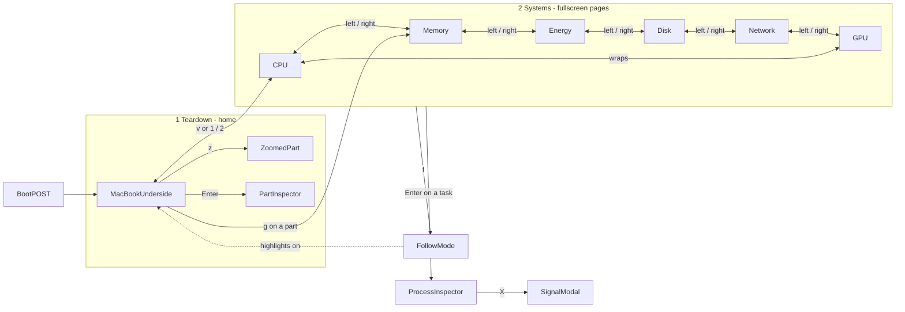
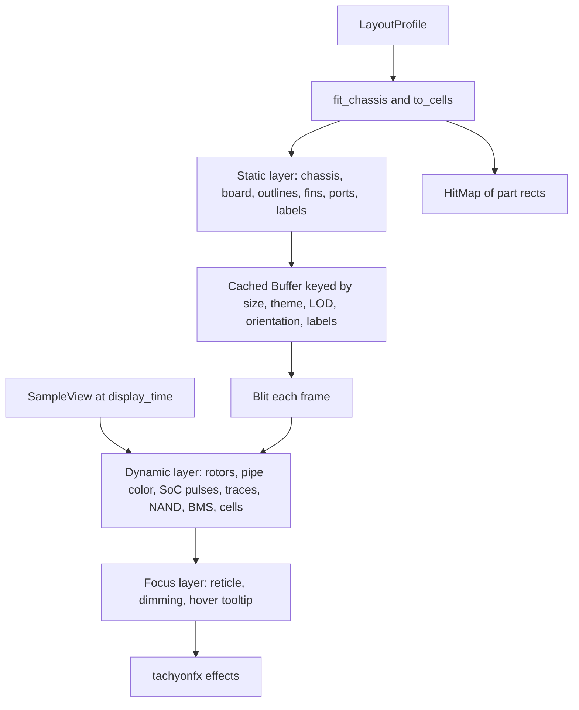
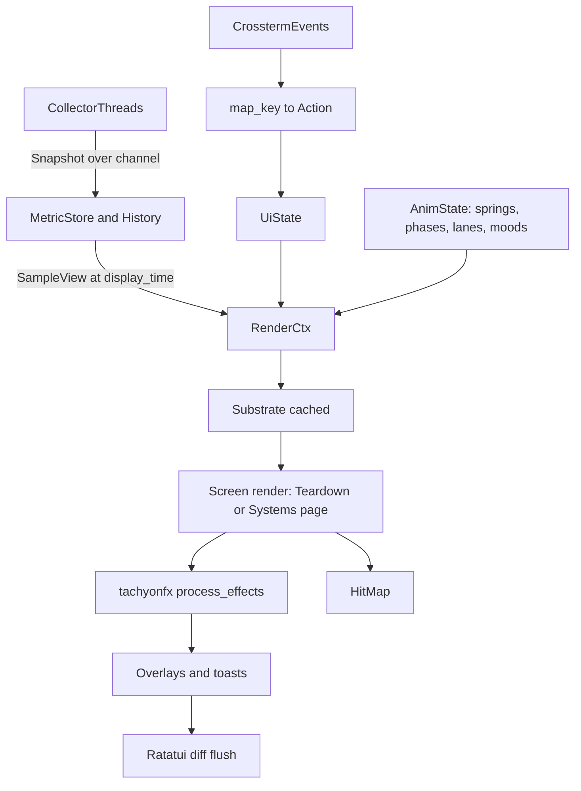

# CHIP//LIVE — UI/UX Design Specification

Design codename **HOLO-SCAN**: *a J.A.R.V.I.S.-style diagnostic scanner looking through the bottom case of your MacBook.* Cyan holographic linework, lock-on reticles, power-on self test, live callouts, all of it grounded in real hardware and real numbers.

This document specifies every screen, widget, glyph, color, animation and interaction. It covers the UI layer. Collectors and history only appear where the UI consumes their output.

---

## 0. Grounding (verified during research)

- **Target machine (this Mac):** `Mac16,8` = MacBook Pro 14" 2024, Apple M4 Pro, 2 CPU tiers (8 P + 4 E), 24 GB, macOS 27.0.1. Rust is not installed yet (`brew install rustup && rustup-init`).
- **Crates (current):** `ratatui 0.30.2`, `crossterm 0.29`, `tachyonfx 0.25.2` (shader-like cell effects for Ratatui), `macmon 0.10.0`, `nucleo-matcher 0.3`, `sysinfo 0.40`, `insta` (snapshot tests).
- **macmon 0.10 facts that shape the UI:**
  - `Metrics.cpu_tiers: Vec<CpuTierMetrics { label, freq_mhz, scaled_ratio, active_ratio, cores: Vec<CpuCoreMetrics { die_id, core_id, freq_mhz, scaled_ratio, active_ratio }> }>`. Per-core faces are fully data-driven, and the tier count is dynamic (never assume E/P only).
  - `SocInfo { mac_model, chip_name, memory_gb, cpu_tiers: Vec<CpuTierInfo { label, cores, freqs }>, gpu_cores, gpu_freqs, .. }`. `freqs.last()` gives the tier's max frequency, which scales animation speed.
  - `fans: Vec<FanMetric { name: "fan0".., rpm, max_rpm: Option<u32> }>`, ordered by SMC key. An empty vec means fanless. **SMC index to physical side is not reported**, so the UI must label fans `FAN 0`/`FAN 1` and mark the position mapping as assumed.
  - `temp: TempMetrics { cpu_temp_avg: Option<f32>, gpu_temp_avg: Option<f32> }`.
  - Power fields in watts: `cpu_power, gpu_power, ane_power, ram_power, gpu_ram_power`. `all_power = cpu + gpu + ane` (computed in macmon `src/metrics.rs`). `sys_power` = SMC `PSTR` clamped to `>= all_power`, but it is `**0.0` when the SMC read fails**, so the normalizer must map that to `Unavailable`, never "0 W".
- **Physical layout (iFixit M4 Pro 14" photos, bottom case removed, laptop flipped left-to-right, hinge at top):**
  - Upper ~47%: one full-width logic board with two large blower fans in the upper-left and upper-right, each with an exhaust fin stack along the hinge edge.
  - One heat pipe runs from the left fin stack, dips into the central SoC heatsink plate, and climbs back to the right fin stack. Two dark plates flank the center.
  - Lower half: six battery cells. There is a vertically stacked pair at each outer side, plus two tall center cells split by a vertical battery-management board (BMS) strip. The trackpad recess sits under the center cells at the front.
  - Speakers: narrow vertical modules at the far left and right edges, beside the outer cells.
  - Ports in this flipped view: HDMI + SDXC + 1x TB on the photo-left edge; MagSafe + 2x TB + 3.5 mm jack on the photo-right edge. Antenna / display flex at the hinge center.
  - Reference photos: [battery guide hero](https://guide-images.cdn.ifixit.com/igi/Y1Y4ZBJAwjoJGuJS.full), [logic board guide hero](https://guide-images.cdn.ifixit.com/igi/SyGngLsCxMgPDOqw.full).

---

## 1. North star and UX rules

**North star:** an idle Mac looks like a sleeping machine on a lab bench: dim cyan linework, one breathing LIVE dot, cores dozing. Load wakes it up. Traces fire, fans spin, cores get frantic, and every bit of that motion traces back to a real measurement.

Ten rules that every screen obeys:

1. **Every glow has a number behind it.** Decorative ambient motion is allowed only at very low amplitude and scales with the measured global `energy` (section 6.5).
2. **Calm at idle, alive under load.** The motion budget scales with activity, not with time.
3. **Numbers never jitter.** All values live in fixed-width, right-aligned slots. Motion lives in glyphs and color, never in layout.
4. **Hot colors are reserved.** Amber means measured heat or sustained maximum load. Red means genuine alerts (critical memory pressure, serious/critical thermal state, battery critical, sensor failure). Decoration only uses cyan and white.
5. **One encoding per channel.** Power trace pulse *density* means watts, and pulse *speed* is constant. Fan *rotation speed* means RPM. GPU *lit tile count* means utilization.
6. **Four keys explain the app:** `Tab`, arrows, `Enter`, `Esc`. Everything else is discoverable through the hint dock, `?`, and the `:` command palette.
7. **Esc is always safe.** It pops exactly one layer, never quits, never destroys.
8. **Personality is at most 20%.** Faces are 5 characters and never replace a number.
9. **Honest geometry.** Teardown outlines are styled by provenance (photo-matched, approximate, conceptual).
10. **Degrade, don't break.** Every widget has Large, Medium and Small forms plus an "unavailable" form.

---

## 2. Visual language

### 2.1 Color tokens — HOLO (default theme)

```rust
// src/ui/theme/tokens.rs
use ratatui::style::Color;

const fn rgb(hex: u32) -> Color { Color::Rgb((hex >> 16) as u8, (hex >> 8) as u8, hex as u8) }

#[derive(Clone, Debug)]
pub struct Theme {
    pub name: &'static str,
    // surfaces
    pub void: Color, pub panel: Color, pub substrate: Color,
    // wiring & chrome
    pub wire_dim: Color, pub wire: Color, pub holo: Color, pub holo_hot: Color,
    // text
    pub text: Color, pub text_dim: Color, pub text_faint: Color,
    // subsystem identity (hue = which subsystem; brightness = how much)
    pub cpu_p: Color, pub cpu_e: Color, pub cpu_x: Color,
    pub gpu: Color, pub mem: Color, pub ane: Color,
    pub disk: Color, pub net: Color, pub batt: Color,
    // semantics: reserved, never decorative
    pub ok: Color, pub warn: Color, pub crit: Color,
    pub na: Color, pub replay: Color, pub synthetic: Color,
    // ramps
    pub heat: [Color; 8], // 30 °C … 105 °C
}

pub const HOLO: Theme = Theme {
    name: "holo",
    void: rgb(0x05080B), panel: rgb(0x081017), substrate: rgb(0x0E2230),
    wire_dim: rgb(0x12384A), wire: rgb(0x1F6F8B), holo: rgb(0x3FE0FF), holo_hot: rgb(0xC8F8FF),
    text: rgb(0xD3E9F2), text_dim: rgb(0x6E8A99), text_faint: rgb(0x3D5563),
    cpu_p: rgb(0x2EF2C4), cpu_e: rgb(0x94E8D2), cpu_x: rgb(0xC9F2E6),
    gpu: rgb(0x6C7BFF), mem: rgb(0x38B6FF), ane: rgb(0xFF6FD8),
    disk: rgb(0xA98BFF), net: rgb(0x9DFF5C), batt: rgb(0x34D399),
    ok: rgb(0x34D399), warn: rgb(0xFFB020), crit: rgb(0xFF3B5C),
    na: rgb(0x4A5A66), replay: rgb(0xE8E3FF), synthetic: rgb(0xF5E663),
    heat: [rgb(0x1B4B5A), rgb(0x23708A), rgb(0x3FA7C4), rgb(0x9FD8D0),
           rgb(0xF2D59B), rgb(0xFFB020), rgb(0xFF6A3D), rgb(0xFF3B5C)],
};

pub fn blend(a: Color, b: Color, t: f32) -> Color {
    let (Color::Rgb(ar, ag, ab), Color::Rgb(br, bg, bb)) = (a, b) else { return if t < 0.5 { a } else { b } };
    let l = |x: u8, y: u8| (x as f32 + (y as f32 - x as f32) * t.clamp(0.0, 1.0)).round() as u8;
    Color::Rgb(l(ar, br), l(ag, bg), l(ab, bb))
}

pub fn ramp(stops: &[Color], t: f32) -> Color {
    let x = t.clamp(0.0, 1.0) * (stops.len() - 1) as f32;
    let i = x.floor() as usize;
    blend(stops[i], stops[(i + 1).min(stops.len() - 1)], x - i as f32)
}

pub fn heat_t(celsius: f32) -> f32 { ((celsius - 30.0) / 75.0).clamp(0.0, 1.0) }
```

Usage rules:

- **Hue map:** cyan = chrome/focus, teal = CPU (P bright, E pale, same family), indigo = GPU, azure = memory, magenta = ANE, violet = storage, lime = network, emerald = battery, white pulse heads = electricity, amber/red = heat and alerts only.
- **Intensity encodes magnitude.** Use `blend(wire_dim, domain_color, level)`, never a hue shift. High CPU is *bright teal*, not red.
- `text_dim` on `void` is about 5.5:1 contrast (OK for labels and units). `text_faint` is about 2.5:1, so it is used for decoration only, never information.
- Truecolor is detected via `COLORTERM=truecolor|24bit`. Otherwise every theme is quantized to xterm-256 once at startup (tachyonfx also provides `fx::term256_colors()` for effects).

### 2.2 Glyph policy

Single-width, no emoji, no Emoji_Presentation characters (they break cell math). Assume East-Asian-ambiguous characters are narrow (the default in macOS terminals). Avoid circled digits (spotty font coverage).

- **Frames:** rounded `╭╮╰╯─│` (idle), heavy `┏┓┗┛━┃` (focused, P-cores), double `╔╗╚╝═║` (heat pipe, buses).
- **Provenance strokes:** solid `─│` photo-matched; dashed `┄┆` approximate; dotted `┈┊` conceptual.
- **Traces:** `─ │ ┌ ┐ └ ┘ ├ ┤ ┬ ┴ ┼` dormant, `━ ┃ ┣ ┫ ┳ ┻ ╋` energized, pin stubs `┴ ┬ ┤ ├`, vias `•`.
- **Data:** braille `U+2800–28FF` (2x4 dots per cell, square dots at a 2:1 cell aspect); eighth blocks `▁▂▃▄▅▆▇█` and `▏▎▍▌▋▊▉`; shades `░▒▓█`; half blocks `▀▄`.
- **Icons:** `◈` chip, `▦` array, `◇◆` ANE nodes, `▣` wired, `■` app, `⣿` compressed, `▒` cached, `·` free, `ϟ` power, `≋` airflow/heat, `⇅` storage, `⇄` network, `▮` battery, `◎` reticle/follow, `⊘` unsupported, `✕` failed, `—` no hardware, `≈` estimated/approximate, `▾` spike marker, `◆` playhead.
- **Faces:** ASCII only (section 7.1).
- `--ascii` / `ui.glyphs = "ascii"` fallback: braille becomes `.:|` density bars, `▰` becomes `#`, `◈` becomes `*`. Box drawing is kept (universally supported).
- **Recommended fonts:** JetBrains Mono, Iosevka, Fira Code (full braille plus box drawing). `--probe` prints a glyph test sheet so users can check their font.

### 2.3 Typography and number formatting

- **Panel titles:** `◈ CPU COMPLEX`, uppercase, bold, `holo` when focused, `text_dim` when idle.
- **Labels:** uppercase 3–5-letter abbreviations in `text_dim`: `ACT SCL FREQ PWR TEMP LOAD`.
- **Values:** bold `text`; units in `text_dim` separated by a space: `4.21 W`.
- **Microcopy:** no exclamation marks; explanations in sentence case; the same unit spelling everywhere.

```rust
// src/ui/kit/fmt.rs — every formatter writes a fixed-width, right-aligned slot (no jitter)
use std::fmt::Write;

pub fn pct(out: &mut String, ratio: f32) {            // 6: "  4.2%" " 42.7%" "100.0%"
    let _ = write!(out, "{:>5.1}%", (ratio * 100.0).clamp(0.0, 100.0));
}
pub fn proc_cpu(out: &mut String, pct: f32) {        // 7: "  3.1%" " 182.4%" "1200.0%"
    let _ = write!(out, "{:>6.1}%", pct.clamp(0.0, 9999.9));
}
pub fn watts(out: &mut String, w: f32) {             // 7: " 0.42 W" " 4.21 W" " 38.0 W"
    let _ = if w < 10.0 { write!(out, "{:>5.2} W", w) } else { write!(out, "{:>5.1} W", w) };
}
pub fn freq(out: &mut String, mhz: u32) {            // 8: "3.91 GHz" " 972 MHz"
    let _ = if mhz >= 1000 { write!(out, "{:>4.2} GHz", mhz as f32 / 1000.0) }
            else { write!(out, "{:>4} MHz", mhz) };
}
pub fn bytes(out: &mut String, b: u64) {             // 6: "17.2 G" " 412 M"
    const U: [&str; 5] = ["B", "K", "M", "G", "T"];
    let (mut v, mut i) = (b as f64, 0);
    while v >= 1024.0 && i < U.len() - 1 { v /= 1024.0; i += 1; }
    let _ = if v < 10.0 { write!(out, "{:>4.1} {}", v, U[i]) } else { write!(out, "{:>4.0} {}", v, U[i]) };
}
pub fn rpm(out: &mut String, r: u32) {               // 5: "2,412" "    0"
    let _ = if r >= 1000 { write!(out, "{},{:03}", r / 1000, r % 1000) } else { write!(out, "{:>5}", r) };
}
```

Units are configurable: `units.bytes = "binary" | "si"`, `units.temp = "c" | "f"`, `units.net = "bytes" | "bits"`.

### 2.4 Hero numerals (3x3 heavy-line font)

Used for big readouts in zoom views and the inspector header. This gives the instrument-cluster feel.

```rust
// src/ui/kit/digits.rs
const DIGITS: [[&str; 3]; 10] = [
    ["┏━┓", "┃ ┃", "┗━┛"], ["╺┓ ", " ┃ ", "╺┻╸"], ["╺━┓", "┏━┛", "┗━╸"], ["╺━┓", " ━┫", "╺━┛"],
    ["╻ ╻", "┗━┫", "  ╹"], ["┏━╸", "┗━┓", "╺━┛"], ["┏━╸", "┣━┓", "┗━┛"], ["╺━┓", "  ┃", "  ╹"],
    ["┏━┓", "┣━┫", "┗━┛"], ["┏━┓", "┗━┫", "╺━┛"],
];
pub fn draw_number(buf: &mut Buffer, x: u16, y: u16, s: &str, style: Style) {
    for (i, d) in s.chars().filter_map(|c| c.to_digit(10)).enumerate() {
        for (row, line) in DIGITS[d as usize].iter().enumerate() {
            buf.set_string(x + i as u16 * 4, y + row as u16, line, style);
        }
    }
}
```

```text
╺━┓ ╻ ╻ ╺┓  ╺━┓
┏━┛ ┗━┫  ┃  ┏━┛   rpm
┗━╸   ╹ ╺┻╸ ┗━╸
```

### 2.5 HUD panel anatomy

```text
idle       ╭─◈ UNIFIED MEMORY ─────────────────────── 17.2 / 24.0 GB ─╮
           │ content                                                    │
           ╰─ ϟ DRAM 0.31 W ────────────────────────────────────────────╯

focused    ┏━◈ UNIFIED MEMORY ━━━━━━━━━━━━━━━━━━━━━━━ 17.2 / 24.0 GB ━┓   <- holo; a 6-cell white
           ┃ content                                                    ┃      comet runs once around
           ┗━ ϟ DRAM 0.31 W ━━━━━━━━━━━━━━━━━━━━━━━━━━━━━━━━━━━━━━━━━━━━┛      the border (450 ms)

alert      ╭─◈ UNIFIED MEMORY ─── PRESSURE WARN ──── 21.9 / 24.0 GB ─╮   <- border pulses wire_dim<->warn at 1 Hz
```

```rust
// src/ui/kit/hud_frame.rs
pub enum FrameState { Idle, Focused { since: f32 }, Alert(Severity) }

pub struct HudFrame<'a> {
    pub icon: &'a str, pub title: &'a str,
    pub readout: Option<Line<'a>>, pub footer: Option<Line<'a>>,
    pub state: FrameState, pub ctx: &'a RenderCtx<'a>,
}

impl HudFrame<'_> {
    /// Draws the frame and returns the inner content area.
    pub fn render(self, area: Rect, buf: &mut Buffer) -> Rect {
        let th = self.ctx.theme;
        let (set, edge, title_fg) = match self.state {
            FrameState::Idle => (border::ROUNDED, th.wire_dim, th.text_dim),
            FrameState::Focused { .. } => (border::THICK, th.holo, th.holo),
            FrameState::Alert(s) => (border::ROUNDED, self.ctx.pulse(th.wire_dim, s.color(th), 1.0), s.color(th)),
        };
        let title = Line::from(vec![
            Span::styled(self.icon, Style::new().fg(title_fg)),
            Span::styled(format!(" {} ", self.title), Style::new().fg(title_fg).bold()),
        ]);
        let mut block = Block::bordered().border_set(set)
            .border_style(Style::new().fg(edge)).style(Style::new().bg(th.panel)).title_top(title);
        if let Some(r) = self.readout { block = block.title_top(r.right_aligned()); }
        if let Some(f) = self.footer { block = block.title_bottom(f); }
        let inner = block.inner(area);
        block.render(area, buf);
        if let FrameState::Focused { since } = self.state { glint(area, buf, self.ctx.t - since, th.holo_hot); }
        inner
    }
}

fn glint(area: Rect, buf: &mut Buffer, age: f32, hot: Color) {
    const DUR: f32 = 0.45; const TAIL: usize = 6;
    if age >= DUR || area.width < 2 || area.height < 2 || !CTX_MOTION_FULL { return; }
    let per = 2 * (area.width + area.height) as usize - 4;
    let head = ((age / DUR) * per as f32) as usize;
    for k in 0..TAIL {
        let Some(i) = head.checked_sub(k) else { break };
        if let Some(c) = buf.cell_mut(perimeter_pos(area, i)) { c.set_fg(blend(hot, c.fg, k as f32 / TAIL as f32)); }
    }
}

/// Clockwise from the top-left corner.
fn perimeter_pos(r: Rect, i: usize) -> Position {
    let (w, h) = (r.width as usize, r.height as usize);
    let (x, y) = if i < w { (i, 0) }
        else if i < w + h - 1 { (w - 1, i - w + 1) }
        else if i < 2 * w + h - 2 { (w - 1 - (i - (w + h - 2)), h - 1) }
        else { (0, h - 1 - (i - (2 * w + h - 3))) };
    Position::new(r.x + x as u16, r.y + y as u16)
}
```

### 2.6 Substrate, bloom, depth

- **Substrate:** the background is a PCB dot grid (`·` every 4 columns x 2 rows in `substrate`) with a few faint static ghost traces. It is rasterized once per resize into a cached `Buffer` and blitted (`tachyonfx::blit_buffer`).
- **Bloom:** for a few hot elements only (spinning fans above 50% of max, an SoC above 70% load, a focused reticle), tint the background of the 1-cell halo around the element `blend(void, color, 0.10 * level)`. It is cheap and reads as glow.
- **Depth order:** substrate, then panels (`panel` bg), then dynamic content, then effects, then overlays (with `void` dim behind), then toasts.

---

## 3. Information architecture and input model

Two screens. **Teardown is the home screen** (it opens on launch). **Systems** is one fullscreen screen with six pages that `←`/`→` swaps between, in Activity Monitor's familiar order plus GPU. The Board and Processes screens are gone. Their widgets live on in the Systems pages, and every page's task list carries the full process tooling.



**Input modes**, with routing priority from top to bottom: `Modal` (signal confirm), `TextEntry` (search, palette), `Overlay` (help), `Screen`, `Global`.

### 3.1 Keymap (conflict-free)

The spec's `k`=kill and `h`/`l`=highlight/labels collide with vim navigation. They are resolved as shown below, and the help screen documents this.

**Who owns the arrow keys:** on Teardown, arrows move between parts. On Systems, `←`/`→` swap pages and `↑`/`↓` move through the task list. When a process inspector drawer is open, the drawer takes `←`/`→` for its tabs, and `Esc` hands them back to page swapping. The page strip greys its `◂ ▸` arrows while the drawer owns them, so the state is always visible.

- **Global:** `1` Teardown · `2` Systems (last page viewed) · `v` toggles Teardown/Systems · `Enter` inspect · `z` zoom (Teardown) / expand the visualizer (Systems) · `Esc` back · `/` filter tasks (from Teardown it opens Systems with the filter ready) · `f` follow the selected process · `:` command palette · `?` help · `t` theme · `a` motion (full, reduced, off) · `q` quit
- **Time:** `Space` pause/play · `,` `.` step one sample · `<` `>` step ten · `{` `}` previous/next spike · `[` `]` window (1m, 5m, 15m, 1h) · `+` `-` replay speed · `End` go live
- **Teardown:** `Tab`/`Shift+Tab` next/prev part · arrows or `h j k l` spatial move · `m` physical/telemetry cells · `L` labels · `H` highlight active hardware · `g` open the selected part's Systems page
- **Systems:** `←` `→` / `h` `l` / `Tab` `Shift+Tab` previous/next page (wraps) · `↑` `↓` or `j` `k` move through tasks (an open inspector follows) · `PgUp` `PgDn` scroll a screenful · `s` cycle sort · `S` reverse · `T` tree, with `Shift+←` `Shift+→` collapse/expand · `X` send signal (confirmation)
- **Mouse:** click a part or a task to select it, click a page tab to jump to that page, double-click zooms a part or opens a task's inspector, the wheel scrolls lists and steps the timeline when over the rail, dragging the rail scrubs, and hovering for 250 ms shows a tooltip on Wide layouts.

The Teardown `g` jumps map like this: SoC → CPU, memory plates → Memory, PMU / BMS / battery / heat pipe / fans → Energy, NAND → Disk, antenna → Network. In cells mode a cell opens the page of its assigned metric (CPU → CPU, GPU → GPU, memory → Memory, power / thermal / battery → Energy).

```rust
// src/app/action.rs
#[derive(Clone, Copy, Debug, PartialEq, Eq)]
pub enum Action {
    Quit, Help, Palette, GoTo(Screen), ToggleScreen, OpenPartPage, ToggleCellMode,
    NextPart, PrevPart, Move(Dir), Inspect, Zoom, Back, PageList(i32), GoPage(Page),
    Search, CycleSort, ReverseSort, ToggleTree, TreeFold(bool), Follow, Signal,
    PlayPause, Step(i32), Spike(i32), Window(i32), Speed(i32), GoLive,
    CycleTheme, CycleMotion, ToggleLabels, ToggleHighlight,
}

pub fn map_key(k: KeyEvent, screen: Screen) -> Option<Action> {
    use KeyCode::*;
    let systems = screen == Screen::Systems;
    let shift = k.modifiers.contains(KeyModifiers::SHIFT);
    Some(match k.code {
        Left if systems && shift => Action::TreeFold(true),
        Right if systems && shift => Action::TreeFold(false),
        Char('q') => Action::Quit,            Char('?') => Action::Help,
        Char(':') => Action::Palette,         Char('/') => Action::Search,
        Char('1') => Action::GoTo(Screen::Teardown), Char('2') => Action::GoTo(Screen::Systems),
        Char('v') => Action::ToggleScreen,
        Tab => Action::NextPart,              BackTab => Action::PrevPart,  // Systems: next/prev page
        Left | Char('h') => Action::Move(Dir::Left),  Right | Char('l') => Action::Move(Dir::Right), // Systems: page swap
        Up | Char('k') => Action::Move(Dir::Up),      Down | Char('j') => Action::Move(Dir::Down),
        PageUp if systems => Action::PageList(-1),    PageDown if systems => Action::PageList(1),
        Enter => Action::Inspect,             Char('z') => Action::Zoom, Esc => Action::Back,
        Char(' ') => Action::PlayPause,       Char(',') => Action::Step(-1), Char('.') => Action::Step(1),
        Char('<') => Action::Step(-10),       Char('>') => Action::Step(10),
        Char('{') => Action::Spike(-1),       Char('}') => Action::Spike(1),
        Char('[') => Action::Window(-1),      Char(']') => Action::Window(1),
        Char('+') => Action::Speed(1),        Char('-') => Action::Speed(-1), End => Action::GoLive,
        Char('t') => Action::CycleTheme,      Char('a') => Action::CycleMotion,
        Char('m') if screen == Screen::Teardown => Action::ToggleCellMode,
        Char('L') if screen == Screen::Teardown => Action::ToggleLabels,
        Char('H') if screen == Screen::Teardown => Action::ToggleHighlight,
        Char('g') if screen == Screen::Teardown => Action::OpenPartPage,
        Char('s') if systems => Action::CycleSort,
        Char('S') if systems => Action::ReverseSort,
        Char('T') if systems => Action::ToggleTree,
        Char('f') => Action::Follow,
        Char('X') if systems => Action::Signal,
        _ => return None,
    })
}
```

On Systems, `Move` is resolved by `SystemsScreen::route` (section 9.1): left/right swap pages unless the inspector drawer is open, and up/down move the task cursor.

### 3.2 Esc back stack (exactly one layer per press)

```rust
fn back(&mut self) {
    if self.modal.take().is_some() { return; }
    if self.palette.take().is_some() || self.help.take().is_some() { return; }
    if self.search.clear_or_close() { return; }
    if self.inspector.close() { return; }                  // part inspector or process drawer
    if self.zoom.take().is_some() { return; }               // Teardown zoom
    if std::mem::take(&mut self.systems.expanded) { return; } // Systems visualizer expanded with z
    if self.selection.take().is_some() { return; }          // Teardown part or Systems task
    if self.follow.take().is_some() { return; }
    if self.timeline.is_paused() { self.timeline.go_live(); }
}
```

---

## 4. Global chrome and responsive frame

### 4.1 Size classes

```rust
#[derive(Clone, Copy, PartialEq, Eq, PartialOrd, Ord, Debug)]
pub enum SizeClass { TooSmall, Compact, Regular, Wide }

impl SizeClass {
    pub fn of(a: Rect) -> Self {
        match (a.width, a.height) {
            (w, h) if w < 60 || h < 18 => Self::TooSmall,   // friendly resize card
            (w, h) if w < 100 || h < 30 => Self::Compact,    // 80x24 classic
            (w, h) if w < 150 || h < 42 => Self::Regular,    // ~120x36
            _ => Self::Wide,                                 // full-screen laptop, ~200x55
        }
    }
}

pub fn chrome(area: Rect, size: SizeClass) -> [Rect; 4] {
    Layout::vertical([
        Constraint::Length(1),                                              // top bar
        Constraint::Fill(1),                                                // stage
        Constraint::Length(if size >= SizeClass::Regular { 2 } else { 1 }), // chrono-rail
        Constraint::Length(1),                                              // hint dock
    ]).areas(area)
}
```

### 4.2 Top bar

```text
Wide     CHIP//LIVE ◈ Apple M4 Pro · 8P+4E · 16-core GPU · 24 GB    ▸1 TEARDOWN◂  2 SYSTEMS      THERMAL NOMINAL   ϟ SYS 14.8 W   ● LIVE 14:02:11
Regular  CHIP//LIVE ◈ M4 Pro 8P+4E 24G    ▸1 TEARDOWN◂ 2 SYSTEMS            NOMINAL  ● LIVE 14:02
Compact  CHIP//LIVE ◈ M4 Pro    ▸TEAR◂ SYS                         ● LIVE 14:02
```

On the Systems screen, a **page strip** sits directly under the top bar (section 9.2). It is part of the Systems stage, not global chrome.

- **Logo:** the `//` slowly shimmers (`holo` to `holo_hot`, 0.3 Hz) while live and freezes when paused.
- **Status badge, one at a time:**
  - `● LIVE` (emerald dot breathing at 0.5 Hz)
  - `▮▮ PAUSED −00:12` (holo)
  - `▶ REPLAY 2x −02:41` (replay color)
  - `● STALE 4s` (warn, when the collector has missed more than 3 intervals)
  - `╱╱ SYNTHETIC · gpu-burst ╱╱` (synthetic color, hatched, always visible in `--demo`)
- **Follow beacon** (when following a process): `◎ python3 #41237 182% · 2.1G` goes before the badge.
- **Thermal state chip:** `THERMAL NOMINAL|FAIR|SERIOUS|CRITICAL`. Nominal/fair are dim; serious is warn; critical is crit and pulsing.

### 4.3 Chrono-rail (always visible, bottom)

```text
 5m ⣀⣀⣠⣤⣤⣀⣀⣀⣀⣠⣤⣴⣶⣾⣿⣷⣶⣤⣀⣀⣀⣀⣀⣀⣠⣤⣴⣶⣾⣿⣿⣷⣶⣤⣀⣀⣀⣀▾⣀⣀⣀⣀⣠⣤⣴⣶⣶⣤⣀⣀⣀⣀⣀⣀⣀⣀⣀⣀⣀⣀⣀⣀⣀⣀⣀⣀◆ NOW
    -5:00              -4:00              -3:00              -2:00              -1:00             0
```

- It plots CPU (teal) with GPU (indigo) overlaid, as braille at 2 samples per cell. When the window holds more samples than fit, it **max-pools** them so spikes never vanish.
- `▾` spike markers appear where the value is above `mean + 2.5σ` and above 50%, at most one every 10 s. Each marker takes the color of the domain that spiked.
- The playhead `◆` sits at `NOW` when live. When paused it moves left and a dim `NOW` marker stays at the right edge.

### 4.4 Hint dock (context-sensitive, 5–8 hints)

Keycaps render as reverse-video `text_dim` chips.

- **Teardown:** `↹ next part · ⏎ inspect · z zoom · g open page · m cells · v systems · ? help`
- **Teardown (zoomed):** `⏎ details · ←→ sibling part · g open page · Esc back`
- **Systems:** `←→ page · ↑↓ task · ⏎ inspect · / filter · s sort · f follow · z expand · v teardown`
- **Systems (inspector open):** `←→ tab · ↑↓ task · PgUp/PgDn scroll · X signal · f follow · Esc close`
- **Paused:** `, . step · < > ×10 · { } spikes · ␣ play · End live`
- **Text entry:** `type to filter · ↑↓ choose · ⏎ open · Esc clear`

When `--debug` is set, the right edge shows `30fps · 1.8ms · cpu 1.2% · macmon 1002ms`.

---

## 5. Boot sequence — POWER-ON SELF TEST

Purpose: it covers the first-sample latency (macmon blocks for one interval), and it truthfully reports which sensors exist. That doubles as a visual `--probe`. It is skippable with any key, skipped under `motion != full`, and shown only on launch.

```text
                            ┏━━━━━━━━━━━━━━━━━━━━━━━━━━━━━━━━━━━━━━┓
                            ┃   C H I P / / L I V E        v0.1.0  ┃
                            ┗━━━━━━━━━━━━━━━━━━━━━━━━━━━━━━━━━━━━━━┛
              ╭────────────────────────────────────────────────────────────────╮
              │  MacBook Pro 14" (Mac16,8) · Apple M4 Pro · macOS 27.0.1        │
              │                                                                 │
              │  POST  SOC TOPOLOGY ............ 8P + 4E · 16-core GPU   [  OK ]│
              │  POST  IOREPORT ................ residency + energy      [  OK ]│
              │  POST  SMC ..................... 2 fans · CPU/GPU temps  [  OK ]│
              │  POST  SYSTEM POWER (PSTR) ..... readable                [  OK ]│
              │  POST  BATTERY ................. AppleSmartBattery       [  OK ]│
              │  POST  MEMORY PRESSURE ......... sysctl                  [  OK ]│
              │  POST  PER-PROCESS GPU ......... not exposed             [ N/A ]│
              │  POST  TEARDOWN PROFILE ........ mbp14-2024-m4pro        [  OK ]│
              │                                                                 │
              │  ▕██████████████████████████████████▍           ▏ acquiring…    │
              ╰────────────────────────────────────────────────────────────────╯
```

Timeline (at most 1.6 s, or until the first sample plus 200 ms, whichever is later):

- **0–220 ms:** a scanline sweeps top to bottom (`fx::sweep_in(Motion::UpToDown, …)`).
- **150–700 ms:** the logo forms from glyph noise (`fx::evolve_into` or `fx::coalesce`).
- **300–1200 ms:** POST lines type at 3 ms per character. Each status is the real probe result (`[ OK ]` in ok, `[ N/A ]` in na, `[FAIL]` in crit).
- **On the first sample:** the POST card dissolves and the Teardown powers on. The chassis outline draws first, then parts `coalesce` from the hinge downward, staggered 40 ms apart (fins, fans, SoC, board, cells). If launched with `--view systems`, the current page's visualizer and task list coalesce instead.

```rust
// src/ui/motion/boot.rs
use tachyonfx::{fx, Effect, Interpolation as I, Motion};

pub fn boot_fx(th: &Theme, logo: Rect, post: Rect) -> Effect {
    fx::sequence(&[
        fx::sweep_in(Motion::UpToDown, 8, 0, th.void, (220, I::QuadOut)),
        fx::parallel(&[
            fx::coalesce((550, I::SineOut)).with_area(logo),
            fx::sweep_in(Motion::LeftToRight, 16, 0, th.void, (650, I::CubicOut)).with_area(post),
        ]),
    ])
}

pub fn panels_power_on(panels: &[Rect]) -> Effect {
    let fxs: Vec<Effect> = panels.iter().enumerate()
        .map(|(i, r)| fx::delay(40 * i as u32, fx::coalesce((300, I::QuadOut))).with_area(*r))
        .collect();
    fx::parallel(&fxs)
}
```

Before the first sample arrives (or when `--no-animation` skips the boot), panels show an **ACQUIRING** skeleton: outlines are drawn and placeholder bars `▱▱▱▱▱` get a slow left-to-right shimmer, with the caption `acquiring · first sample in ~1 s`.

---

## 6. Motion system

### 6.1 Frame loop with adaptive FPS

```rust
// src/app/run.rs
pub fn run(mut terminal: DefaultTerminal, mut app: App) -> color_eyre::Result<()> {
    let mut last = Instant::now();
    loop {
        while let Ok(snap) = app.rx.try_recv() { app.ingest(snap); }   // never blocks
        let now = Instant::now();
        let dt = now - last; last = now;
        app.tick(dt);                                                   // springs, phases, lanes, timeline
        if app.needs_redraw() { terminal.draw(|f| ui::draw(f, &mut app, dt))?; }
        let timeout = app.frame_budget().saturating_sub(now.elapsed());
        if event::poll(timeout)? {
            match event::read()? {
                Event::Key(k) if k.kind == KeyEventKind::Press => app.on_key(k),
                Event::Mouse(m) => app.on_mouse(m),
                Event::Resize(..) => app.on_resize(),           // invalidates static layer caches
                Event::FocusLost => app.window_focused = false,
                Event::FocusGained => app.window_focused = true,
                _ => {}
            }
        }
        if app.should_quit { return Ok(()); }
    }
}

impl App {
    fn frame_budget(&self) -> Duration {
        let fps = match (self.motion, self.window_focused) {
            (Motion::Off, _) => 2.0,                              // clock + new samples only
            (_, false) => 4.0,                                    // terminal in background
            _ if self.fx.is_running() || self.anim.any_continuous() => self.cfg.fps as f32, // 30 default
            _ => 12.0,                                            // idle Mac: calm and cheap
        };
        Duration::from_secs_f32(1.0 / fps)
    }
}
```

`any_continuous()` is true when any fan RPM is above 0, any core lane has blocks, any trace has a nonzero rate, or any transition is running. Terminal setup: `ratatui::init()` plus `EnableMouseCapture` and `EnableFocusChange`. Restore on exit and in the panic hook (`DisableMouseCapture`, `DisableFocusChange`, `ratatui::restore()`).

### 6.2 Value smoothing (visual magnitudes only)

**Numeric text always shows the exact sample.** Bar lengths, glow intensities and gauge sweeps chase the sample with a critically damped spring, so 1 Hz steps look fluid. In replay, springs **snap** so the frame equals the historical value.

```rust
// src/ui/motion/spring.rs — frame-rate independent, no overshoot
#[derive(Default, Clone, Copy)]
pub struct Spring { pub pos: f32, vel: f32 }
impl Spring {
    pub fn step(&mut self, target: f32, dt: f32, smooth_time: f32) {
        let omega = 2.0 / smooth_time.max(1e-3);
        let x = omega * dt;
        let exp = 1.0 / (1.0 + x + 0.48 * x * x + 0.235 * x * x * x);
        let change = self.pos - target;
        let temp = (self.vel + omega * change) * dt;
        self.vel = (self.vel - omega * temp) * exp;
        self.pos = target + (change + temp) * exp;
    }
    pub fn snap(&mut self, v: f32) { self.pos = v; self.vel = 0.0; }
}
```

### 6.3 Phase accumulators (truthful continuous motion)

Continuous motion (fan rotation, packets, lanes, pulses) advances a phase by `rate(sample) * dt`, where `rate` is a pure function of the **displayed** sample. In replay the motion keeps moving, but its *speed* reflects the historical value, so it never implies wrong data.

```rust
#[derive(Default)]
pub struct Phase(f64);
impl Phase {
    pub fn advance(&mut self, rate_per_sec: f32, dt: f32) -> f32 {
        self.0 = (self.0 + rate_per_sec as f64 * dt as f64).rem_euclid(1.0);
        self.0 as f32
    }
}
```

### 6.4 Motion tokens

- **Durations:** `snap` 90 ms · `quick` 160 ms · `base` 240 ms · `slow` 420 ms · `boot` up to 1600 ms.
- **Easing:** enter uses `QuadOut`/`CubicOut`; exit uses `QuadIn`; emphasis uses `SineInOut`. **No bounce or elastic**, because it reads as toy-like.
- **Ambient pulse frequency cap:** 2 Hz. Alert pulse: 1 Hz.
- **Deterministic jitter:** any "random" timing (blinks, spawn offsets) comes from `hash(component_id, floor(t / period))`, so demo recordings are reproducible.

### 6.5 Global energy (calm at idle)

```rust
let raw = [m.cpu_active, m.gpu_active, log_norm(m.all_power, 0.3, 40.0), m.disk_activity, m.net_activity]
    .into_iter().fold(0.0f32, f32::max);
self.energy.step(raw, dt, 3.0); // slow: 3 s smoothing
```

`energy` scales only decorative amplitude: substrate shimmer, bus-spine base brightness, ambient blink rate. At `energy < 0.05`, the only motion left is spinning fans (if any), the breathing LIVE dot, occasional core `z`s and blinks.

### 6.6 Motion levels (`a` cycles; `--no-animation` means Off)

- **Full:** everything.
- **Reduced:** no boot, glints, ambient loops, slides or dissolves. Metric animations update at sample rate (1 Hz). Fans step one rotor frame per second. Lanes show a static fill `▰▰▰▱▱▱`. Reticle is static.
- **Off:** no animation of any kind. Redraws happen on data or input only. Every value and color is still present.

### 6.7 What uses tachyonfx vs custom code

- **tachyonfx (one-shot, cosmetic):** boot, part/panel power-on, Teardown/Systems scan sweep, Systems page slide, focus glint fallback, inspector slide-in, zoom content fade, modal background darken, cell-mode transition, toast in/out, replay color grade, theme crossfade.
- **Custom widgets (deterministic, sample-bound):** every metric-driven animation, so replay and tests are exact.

```rust
#[derive(Clone, Copy, Debug, PartialEq, Eq, PartialOrd, Ord)]
pub enum FxKey { Boot, ViewSwitch, PageSwap, Inspector, Zoom, CellMode, Modal, ReplayGrade, Toast(u8), Theme }

// view switch: a scanline wipes the new screen in
app.fx.add_unique_effect(FxKey::ViewSwitch,
    fx::sweep_in(Motion::LeftToRight, 12, 0, th.void, (280, I::QuadOut)).with_area(stage));
// after drawing the frame:
app.fx.process_effects(dt.into(), frame.buffer_mut(), frame.area());
```

---

## 7. Hardware widget kit

Every widget has: data bindings, L/M/S forms, states, animation rules, an unavailable form, and a truth note shown in its inspector. The Teardown parts and the Systems page visualizers are both built from this kit, so a fan, chamber or trace looks and behaves the same on both screens. Panel mockups in this section show each widget in isolation.

### 7.1 CPU core — "execution chamber" (signature element)

**Shape language by tier** (tiers detected at runtime from `cpu_tiers[].label`):

- **Performance** (`label` starts with `P`): heavy frame `┏━┓`, square-bracket "armored" face `[o_o]`, wide blocks `▰`, `cpu_p` teal.
- **Efficiency** (`label` starts with `E`): rounded frame `╭─╮`, round face `(o_o)`, small blocks `▪`, pale `cpu_e`.
- **Any other tier** (future chips): `{o_o}`, dotted frame, `cpu_x`, labelled with macmon's label verbatim.

Large form (16x5 per core):

```text
┏P2━━━━━━━━━━━━┓   ╭E1───────────╮
┃▰▰▰▰▰▰▸ [@_@] ┃   │     · (-_-)z│     lane: symbolic instruction blocks flow into the core
┃⣶⣿⣿⣿⣿⣿⣿⣿⣿⣿⣿⣿⣿┃   │⣀⣀⣀⣀⣀⣀⣀⣀⣀⣀⣀⣀│     per-core 60 s braille history
┗4.51GHz━━━98%┛   ╰0.97GHz────2%╯     per-core measured freq + active residency
```

Medium form (10x2): `P2[@_@]98` over `▇██████▇█▆`. Small form (1 row): `P2 ▕████████▊▏ 98 [@_@]`.

**Mood ladder** (per core, driven by that core's `active_ratio`):

- **Asleep** (<3%): `[-_-]`. A `z` floats up out of the chamber's top-right every ~3.5 s.
- **Idle** (3–15%): `[o_o]`. Blinks to `[-_-]` for 120 ms every 3–6 s (deterministic per core).
- **Light** (15–40%): `[o_o]`. Lane trickles.
- **Busy** (40–70%): `[>_>]` and `[<_<]` alternate as blocks arrive (eyes track the lane).
- **High** (70–90%): `[@_@]`. The chamber interior background glows `blend(panel, tint, 0.12–0.25)` at 2 Hz.
- **Frantic** (≥90% sustained ≥5 s): `[@O@]` plus a sweat mark `'`. The border is heat-ramped toward amber (activity, not error). The lane is saturated.

```rust
// src/ui/components/cpu_chamber.rs
#[derive(Clone, Copy, Debug, PartialEq, Eq, PartialOrd, Ord)]
pub enum Mood { Asleep, Idle, Light, Busy, High, Frantic }

pub struct MoodTracker { mood: Mood, since: f32, hot_since: Option<f32> }

impl MoodTracker {
    const MIN_DWELL: f32 = 0.8;       // seconds before a mood may change again
    const FRANTIC_AFTER: f32 = 5.0;   // sustained >=90 %

    pub fn update(&mut self, active: f32, now: f32) -> Mood {
        self.hot_since = if active >= 0.90 { self.hot_since.or(Some(now)) } else { None };
        let mut target = Self::classify(active, self.mood);
        if matches!(self.hot_since, Some(t0) if now - t0 >= Self::FRANTIC_AFTER) { target = Mood::Frantic; }
        if target != self.mood && now - self.since >= Self::MIN_DWELL { self.mood = target; self.since = now; }
        self.mood
    }

    /// Hysteresis: once at or above a level, you must drop 4 points below its entry threshold to leave it.
    fn classify(a: f32, cur: Mood) -> Mood {
        const LADDER: [(f32, Mood); 4] = [(0.70, Mood::High), (0.40, Mood::Busy), (0.15, Mood::Light), (0.03, Mood::Idle)];
        for (enter, mood) in LADDER {
            let threshold = if cur >= mood { enter - 0.04 } else { enter };
            if a >= threshold { return mood; }
        }
        Mood::Asleep
    }
}

pub fn face(tier: TierKind, mood: Mood, blink: bool, glance_right: bool) -> &'static str {
    let p = matches!(tier, TierKind::Performance);
    match (mood, blink) {
        (Mood::Asleep, _) | (Mood::Idle | Mood::Light, true) => if p { "[-_-]" } else { "(-_-)" },
        (Mood::Idle | Mood::Light, false) => if p { "[o_o]" } else { "(o_o)" },
        (Mood::Busy, _) => match (p, glance_right) {
            (true, true) => "[>_>]", (true, false) => "[<_<]", (false, true) => "(>_>)", (false, false) => "(<_<)" },
        (Mood::High, _) => if p { "[@_@]" } else { "(@_@)" },
        (Mood::Frantic, _) => if p { "[@O@]" } else { "(@O@)" },
    }
}
```

**Instruction lane** (symbolic). Density follows measured active residency; speed follows measured per-core frequency relative to the tier max (`SocInfo.cpu_tiers[i].freqs.last()`).

```rust
pub struct Lane { blocks: Vec<f32>, spawn_acc: f32, rng: SplitMix32 }

impl Lane {
    pub fn tick(&mut self, active: f32, freq_frac: f32, dt: f32, len: f32) {
        let speed = 4.0 + 14.0 * freq_frac;          // cells/s   ∝ measured frequency
        let rate = 8.0 * active;                     // blocks/s  ∝ measured active residency
        for b in &mut self.blocks { *b += speed * dt; }
        self.blocks.retain(|&b| b < len);
        self.spawn_acc += rate * dt;
        while self.spawn_acc >= 1.0 {
            self.spawn_acc -= 1.0;
            if self.blocks.len() < 12 { self.blocks.push(-self.rng.unit()); } // jittered entry
        }
    }
}
// Rendering: block glyph '▰' (P) / '▪' (E). The last 2 cells before the face dissolve '▰'→'▱'→'·'.
```

**Cluster header** (one per tier): `P-CLUSTER ×8   3.92 GHz   ACT 52.0%   SCL 44.1%   <cluster sparkline>`.

**Inspector truth note:** "Instruction blocks are symbolic. Their density follows measured active residency, and their speed follows measured core frequency. They are not decoded instructions."

### 7.2 GPU shader fabric

```text
▓▓█▓▒░▓██▓▓▒·▓▓█▓▒   ⢀⣴⣿⣦⡀  FRAMEBUFFER
█▓▓▒·▓▓██▓░▓▓▓▒▓█▓   ⣿⣿⡿⢿⣿  symbolic
▓▒·▓▓██▓▓▓▒▓█▓▒░▓▓   ⠈⠻⠿⠟⠁
▮▮▮▮▮▮▮▮▮▮▮▮▮▮▮▮ 16 cores · aggregate utilization only
UTIL 63.0%  SCL 48.2%  1.24 GHz  ϟ 5.10 W  SRAM ϟ 0.12 W  54°C
```

- **Tile fabric:** a symbolic grid whose tile count is unrelated to the GPU core count. Lit tiles = `round(gpu_active * N)`, chosen by a **stable permutation**, so +5% adds tiles instead of reshuffling. A diagonal wavefront sweeps at a speed proportional to `gpu_freq_mhz / max`. Brightness glyphs: `· ░ ▒ ▓ █`.
- **Core pips:** `gpu_cores` pips drawn at **one shared brightness** (the aggregate), so nobody can read them as per-core data.
- **Framebuffer:** a braille plasma (sum of sines). Brightness follows `gpu_active` and animation speed follows frequency. At 0% it is dark and static.

```rust
pub fn tile_rank(n: usize, seed: u64) -> Vec<u16> {      // rank[i] = when tile i lights up
    let mut order: Vec<u16> = (0..n as u16).collect();
    let mut rng = SplitMix64(seed);
    for i in (1..n).rev() { order.swap(i, (rng.next() % (i as u64 + 1)) as usize); }
    let mut rank = vec![0u16; n];
    for (r, &tile) in order.iter().enumerate() { rank[tile as usize] = r as u16; }
    rank
}

fn tile_level(rank: u16, lit: u16, x: u16, y: u16, wave_phase: f32, diag: f32) -> f32 {
    let wave = 0.5 + 0.5 * (std::f32::consts::TAU * (wave_phase - (x + y) as f32 / diag)).sin();
    if rank < lit { 0.55 + 0.45 * wave } else { 0.06 + 0.06 * wave }
}
```

### 7.3 ANE lattice

```text
◇─◇─◇─◇─◇      active: nodes become ◆ (count ∝ ane_power / 4 W, log scale),
 ╲╱ ╲╱ ╲╱ ╲╱    a ripple travels along edges at a speed ∝ power
◇─◇─◇─◇─◇
```

- **Idle** (`ane_power < 0.005 W`): `wire_dim`, completely still, caption `IDLE · 0.00 W`.
- **Unavailable:** hatched `╱` fill plus `⊘ ANE power not reported`. Never simulated.

### 7.4 Unified memory — address matrix

```text
▣▣▣▣▣▣▣▣▣▣■■■■■■■■■■■■■■■■■■■■■■■■■■■■■  PRESSURE
■■■■■■■■■■■■■■■■■■■■■■■■■■■⣿⣿⣿⣿⣿⣿⣿⣿⣿⣿⣿⣿  ▕███▍    ▏
▒▒▒▒▒▒▒▒▒▒▒▒▒▒▒▒▒▒▒▒▒▒▒▒▒▒▒▒▒▒▒▒▒▒▒▒▒▒▒▒  NORMAL 31%
········································  SWAP ⇢ NAND
▣ WIRED 3.1G  ■ APP 9.8G  ⣿ COMP 1.9G  ▒ CACHE 4.6G  · FREE 4.6G
```

- Categories are disjoint (Activity Monitor convention: Used = App + Wired + Compressed; Cached = file-backed + purgeable; Free = the rest). They fill in fixed order, row-major. Each cell is `total / N` bytes (Large: N = 40x4 = 160; about 154 MB per cell on 24 GB).
- **Glyphs:** wired `▣` (locked, steel-cyan), app `■` (mem azure), compressed `⣿` (densely packed), cached `▒` (lighter, reclaimable), free `·`.
- **Animations:**
  - Cells changing category crossfade over 300 ms.
  - Growth in compressed memory plays a squeeze `■→▪→⣿` on the transitioning cells.
  - Swap-outs send `▪` blocks along the `⇢ NAND` lane, with spawn rate proportional to swapouts/s. Swap-ins flow back.
- **Pressure:** a bar plus a macOS level word (NORMAL `ok`, WARN `warn`, CRITICAL `crit`) from `kern.memorystatus_vm_pressure_level`. Never invent a threshold.
- **Truth note:** "A symbolic aggregate map, not physical addresses."

```rust
/// Largest-remainder allocation: cell counts always sum to exactly `cells`.
pub fn allocate_cells<const N: usize>(bytes: [u64; N], cells: usize) -> [usize; N] {
    let total: u64 = bytes.iter().sum();
    let mut out = [0usize; N];
    if total == 0 { return out; }
    let mut fracs = [(0usize, 0f64); N];
    for i in 0..N {
        let exact = bytes[i] as f64 * cells as f64 / total as f64;
        out[i] = exact as usize;
        fracs[i] = (i, exact.fract());
    }
    let mut left = cells - out.iter().sum::<usize>();
    fracs.sort_by(|a, b| b.1.total_cmp(&a.1));
    for (i, _) in fracs { if left == 0 { break; } out[i] += 1; left -= 1; }
    out
}
// bytes = [wired, app, compressed, cached, free]
```

### 7.5 NAND / storage chip

```text
  ┌┴┴┴┴┴┴┴┴┴┴┐ ━━▸━━━▸━━  R 312.4 MB/s   1.2k IOPS
──┤▓▓▓▓▓░░░░░├ ◂━━━◂━━━━  W  41.0 MB/s    310 IOPS
  └┬┬┬┬┬┬┬┬┬┬┘ 41% used · 3 volumes
```

- **Pins:** the top pins flash on reads and the bottom pins on writes. The number of distinct flashes per second follows log(IOPS).
- **Streams:** comets on the R/W traces have a length of 1–6 cells, following log(bytes/s). Reads travel outward and writes inward.
- **Body fill:** `▓░` shows used capacity.

### 7.6 Network connectors

```text
═╡◂•───◂•────◂•───  ↓ 24.1 MB/s   18.2k pkt/s
═╡──•▸─────•▸─────  ↑  1.3 MB/s    2.1k pkt/s   ✕ 0 err
```

- Packet `•` spawn rate follows log(packets/s), and brightness follows log(bytes/s). Download travels toward the board and upload travels away.
- Errors and drops: a crit `✕` on the trace plus a count, shown only when nonzero in the window.
- Link line when available: `en0 Wi-Fi · 1201 Mb/s · −52 dBm`. Otherwise `link info: permission required` or `n/a`.

```rust
pub fn log_norm(x: f32, lo: f32, hi: f32) -> f32 { ((x.max(lo) / lo).ln() / (hi / lo).ln()).clamp(0.0, 1.0) }
```

### 7.7 Fan rotor

- **Large:** a braille rotor (square dots) with 9 swept blades, a hub ring and a housing ring. The RPM is centered below: `FAN 0 · 2,412`.
- **Medium:** a 3x3 glyph rotor alternating `[" │ ","─◉─"," │ "]` and `["╲ ╱"," ◉ ","╱ ╲"]`.
- **Small:** a spinner `◐◓◑◒` plus the number.
- **Stopped** (`rpm == 0`, common at idle on M-series): blades are static and dim, with the caption `0 rpm · idle`. This is the calm state.
- **Color:** `ramp(heat, rpm_frac * 0.75)`. Exhaust `≋` particles drift from the fins toward the hinge vent when spinning.
- **Wagon-wheel guard:** visual rotation is a monotonic map of RPM, capped so a frame never advances more than 0.45 of the blade spacing.

```rust
// src/ui/components/fan.rs
pub fn visual_rev_per_sec(rpm: u32, max_rpm: Option<u32>, blades: u32, fps: f32) -> f32 {
    if rpm == 0 { return 0.0; }
    let max = max_rpm.unwrap_or(REFERENCE_MAX_RPM) as f32;     // when unknown, label says "max n/a"
    let frac = (rpm as f32 / max).clamp(0.0, 1.0);
    let strobe_limit = 0.45 * fps / blades as f32;             // 30 fps, 9 blades -> 1.5 rev/s
    (0.2 + 1.8 * frac).min(strobe_limit)
}

pub fn draw_rotor(g: &mut BrailleGrid, cx: f32, cy: f32, r_hub: f32, r_tip: f32, blades: u32, phase: f32, c: Color) {
    use std::f32::consts::TAU;
    for i in 0..blades {
        let a0 = phase * TAU + i as f32 * TAU / blades as f32;
        let mut prev: Option<(f32, f32)> = None;
        for s in 0..=6 {                                       // swept blade: angle lags with radius
            let t = s as f32 / 6.0;
            let (r, a) = (r_hub + (r_tip - r_hub) * t, a0 - 0.55 * t);
            let p = (cx + r * a.cos(), cy + r * a.sin());
            if let Some(q) = prev { g.line(q, p, c); }
            prev = Some(p);
        }
    }
    g.circle(cx, cy, r_hub, c);
    g.circle(cx, cy, r_tip + 1.5, dim(c));
}
```

```rust
// src/ui/kit/braille.rs — per-cell colored braille raster (shared by fans, charts, gauges)
pub struct BrailleGrid { w: u16, h: u16, bits: Vec<u8>, color: Vec<Option<Color>> }
impl BrailleGrid {
    const MAP: [[u8; 2]; 4] = [[0x01, 0x08], [0x02, 0x10], [0x04, 0x20], [0x40, 0x80]];
    pub fn set(&mut self, x: i32, y: i32, c: Color) {
        if x < 0 || y < 0 || x >= self.w as i32 * 2 || y >= self.h as i32 * 4 { return; }
        let i = (y as usize / 4) * self.w as usize + x as usize / 2;
        self.bits[i] |= Self::MAP[y as usize % 4][x as usize % 2];
        self.color[i] = Some(c);
    }
    pub fn flush(&self, area: Rect, buf: &mut Buffer) {
        for (i, &b) in self.bits.iter().enumerate().filter(|(_, b)| **b != 0) {
            let pos = Position::new(area.x + (i % self.w as usize) as u16, area.y + (i / self.w as usize) as u16);
            if let Some(cell) = buf.cell_mut(pos) {
                cell.set_char(char::from_u32(0x2800 + b as u32).unwrap());
                if let Some(c) = self.color[i] { cell.set_fg(c); }
            }
        }
    }
    // line(): Bresenham over dot space; circle(): midpoint circle. Both call set().
}
```

### 7.8 Heat pipe, heatsink, fin stacks

- **Pipe:** double-line path `═║╔╗╚╝` (the pipe look). Color = `ramp(heat, heat_t(max(cpu_temp, gpu_temp)))`, uniform along the pipe. We do not invent a temperature gradient.
- **Heat-flow shimmer:** one `holo_hot`-tinted cell travels from the SoC to the fins every `2.5 − 2.0 * fan_frac` seconds. The direction is physically true and the cadence follows measured airflow.
- **Fins `║║║║`:** heat color multiplied by `(0.6 + 0.4 * fan_frac)`.
- **Thermal state** (from `NSProcessInfo.thermalState`) tints the heatsink outline: nominal none, fair dim amber, serious warn, critical crit plus a 1 Hz pulse.

### 7.9 Power traces (electrical circuitry)

```text
PMU━━•━━━━━━•━━━━━━━•━━  CPU  4.21 W
   ━━━━•━━━━━━━━•━━━━━━  GPU  5.10 W
   ───────────────────   ANE  0.00 W
   ─•──────────────•───  DRAM 0.31 W
Σ CPU+GPU+ANE 9.31 W        SYSTEM (SMC) 14.8 W        ≈ 3.2 Wh since launch
```

- Pulse density = `0.4 + 5.6 * log_norm(watts, 0.05, 40)` pulses/s at a **constant** speed of 14 cells/s. Head is `holo_hot`, then the domain color, then a fading tail.
- Stroke weight: `─` below 1 W, `━` at 1 W and above (a second monotonic cue).
- **Totals rule:** only `Σ CPU+GPU+ANE` (macmon `all_power`) and `SYSTEM (SMC)` (`sys_power`, when valid) are shown. **DRAM and GPU SRAM are never added to Σ.** Energy (Wh) is labelled `≈` because it is an integration.

```rust
pub struct Trace { pub cells: Vec<Position>, phase: f32 }
impl Trace {
    pub fn render(&mut self, buf: &mut Buffer, watts: &Avail<f32>, dt: f32, th: &Theme, base: Color) {
        const SPEED: f32 = 14.0;
        let n = self.cells.len() as f32;
        let pps = match watts { Avail::Ok(w) | Avail::Estimated(w) => 0.4 + 5.6 * log_norm(*w, 0.05, 40.0), _ => 0.0 };
        self.phase = (self.phase + SPEED * dt).rem_euclid(n.max(1.0));
        for (i, p) in self.cells.iter().enumerate() {
            let fg = if pps == 0.0 { th.wire_dim } else {
                let d = (self.phase - i as f32).rem_euclid((SPEED / pps).min(n));
                if d < 1.0 { th.holo_hot } else if d < 2.0 { base } else if d < 3.5 { blend(base, th.wire_dim, 0.6) } else { th.wire_dim }
            };
            if let Some(c) = buf.cell_mut(*p) { c.set_fg(fg); }
        }
    }
}
```

### 7.10 Battery bank

```text
▕████▏▕████▏▕████▏▕████▏▕█▍  ▏▕    ▏ ‹‹‹ MagSafe 67 W
+18.4 W in · full in 0:48 · health 97% · 112 cycles · Low Power Mode off
```

- It is a **segmented pack gauge** drawn as cells. Fill follows pack % across segments. The inspector states: "Segments are a gauge, not individual cells. Per-cell data is not available."
- **Charging:** `‹‹‹` chevrons flow from the adapter into the bank at a rate proportional to the charge watts. **Discharging:** `›››` flows out toward the board at a rate proportional to the discharge watts. **On AC, not charging:** static `= AC`.
- **Desktop Macs:** the panel is replaced by `— no battery · AC powered`. It is not drawn empty.

### 7.11 Charts and gauges

```rust
// src/ui/kit/spark.rs — braille area sparkline: 2 samples/cell, rows*4 levels, newest at the right
pub fn braille_area(buf: &mut Buffer, area: Rect, data: &[f32], max: f32, color: impl Fn(f32) -> Color) {
    let levels = area.height as i32 * 4;
    let n = area.width as usize * 2;
    let slice = &data[data.len().saturating_sub(n)..];
    let offset = n - slice.len();
    let mut g = BrailleGrid::new(area.width, area.height);
    for (i, &v) in slice.iter().enumerate() {
        let h = ((v / max).clamp(0.0, 1.0) * levels as f32).round() as i32;
        for y in 0..h { g.set((offset + i) as i32, levels - 1 - y, color(y as f32 / levels as f32)); } // gradient fill
    }
    g.flush(area, buf);
}
```

- **History chart (inspectors):** a braille area with a gradient fill (dim at the bottom, bright at the top). Grid lines at 25/50/75% use `┈` in `substrate`. Y labels are right-aligned and the time axis reads `-60s -30s now`. Multiple series get a legend. When paused, a vertical cursor `│` sits at the display time, with a value flag `◆ 63.0% @ -02:41`.
- **Arc gauge** (the "reactor ring" for the SoC zoom and the CPU hero): a braille ring with a 270° sweep, ticks every 10%, a filled arc ramped `wire → domain → holo_hot`, and hero digits in the center.

```rust
pub fn arc_gauge(g: &mut BrailleGrid, cx: f32, cy: f32, r: f32, value: f32, lit: impl Fn(f32) -> Color, off: Color) {
    use std::f32::consts::PI;
    const START: f32 = 0.75 * PI; const SWEEP: f32 = 1.5 * PI;   // 135° → 405°, clockwise on screen
    let steps = (r * SWEEP * 1.6) as usize;
    for s in 0..=steps {
        let t = s as f32 / steps as f32;
        let a = START + SWEEP * t;
        let c = if t <= value { lit(t) } else { off };
        for dr in [0.0, 1.0] { g.set((cx + (r - dr) * a.cos()).round() as i32, (cy + (r - dr) * a.sin()).round() as i32, c); }
    }
}
```

- **Meter:** `▕██████▍   ▏` using eighth blocks, colored by domain. Pressure and thermal meters use semantic colors.

### 7.12 Availability states (rendered consistently everywhere)

```rust
// src/metrics/avail.rs — produced by the normalizer, consumed by every widget
pub enum Avail<T> {
    Ok(T),
    Estimated(T),               // shown with a "≈" prefix
    NoHardware(&'static str),   // "no physical fan" — the element is not drawn at all
    Unsupported(&'static str),  // "unsupported on this chip"
    Permission(&'static str),   // "permission required"
    Failed(String),             // "sensor read failed: SMC PSTR"
    Stale { value: T, age_s: u16 },
    Acquiring,
}
```

- `0.0 W` is a valid measured zero and renders normally. It is **never** confused with N/A.
- **Unsupported:** the region is filled with dim `╱` hatching in `na`, with `⊘ UNSUPPORTED` plus a short reason.
- **Failed:** `✕ READ FAILED` in a dimmed warn tone. One toast per session per sensor.
- **Stale:** the value is dimmed with `◌ 4s` appended.
- **NoHardware:** the component is replaced by an honest alternative (passive heatsink art for fanless Macs, `AC powered` for desktops).
- Normalizer special case found in research: `sys_power == 0.0 && all_power > 0.0` becomes `Failed("SMC PSTR unreadable")`.

---
## 8. Screen 1 — MacBook Teardown (home screen, signature view)

The Teardown opens on launch. Its design is unchanged; the only addition is `g`, which jumps from the selected part to the matching Systems page (section 3.1).

### 8.1 View and orientation

- Default is the **underside view**, matching the iFixit photos and the spec: hinge at the top, HDMI/SD side at the photo-left, MagSafe side at the photo-right. The frame title states this explicitly: `UNDERSIDE VIEW · hinge ▲ · HDMI/SD ◀ · MagSafe ▶`.
- Config `teardown.orientation = "xray"` mirrors the x axis, so your left matches the screen's left (`x' = 1 − x − w`). Normalized coordinates make this one line of code.

### 8.2 Layout model (data, not render code)

```rust
// src/ui/teardown/profile.rs
pub struct LayoutProfile {
    pub id: &'static str,
    pub display_name: &'static str,
    pub models: &'static [&'static str],          // hw.model identifiers
    pub aspect: f32,                              // physical width / depth
    pub view: ViewSide,                           // Underside
    pub tab_physical: &'static [CompId],
    pub tab_cells: &'static [CompId],
    pub components: &'static [ComponentSpec],
    pub verified: bool,                           // false → title says "approximate profile"
}

pub struct ComponentSpec {
    pub id: CompId, pub kind: Kind,
    pub label: &'static str, pub short: &'static str,
    pub rect: NRect,                              // normalized 0..1, origin = hinge, photo-left
    pub shape: Shape,
    pub z: u8,
    pub bind: &'static [MetricId],                // what live data animates it
    pub focus: bool,                              // in the Tab cycle?
    pub prov: Prov,                               // Photo | Approximate | Conceptual
    pub detail: Detail,                           // which inspector to open
}

#[derive(Clone, Copy)] pub struct NRect { pub x: f32, pub y: f32, pub w: f32, pub h: f32 }

pub enum Shape {
    Rect { rounded: bool },
    Rotor { center: (f32, f32), tip: f32, blades: u8 },
    Pipe(&'static [(f32, f32)]),
    Fins,
    Chip { pins: bool },
    BatteryCell { slot: u8 },
    PortStack(&'static [&'static str]),
    SpeakerMesh,
    Recess,
}
```

**Profile `mbp14-2024-m4pro`.** It matches `Mac16,8` (14" M4 Pro). `Mac16,6` (14" M4 Max) shares the chassis per iFixit's combined guides, but stays `verified: false` until checked. The base M4 14" uses a different thermal design and must not reuse this profile. Aspect = 312.6 / 221.2 mm.

Normalized coordinates (x across from photo-left, y down from hinge; first pass from the photos, refined with the debug grid overlay):

- `antenna` x 0.34–0.66, y 0.00–0.04. Antenna / display flex. Photo.
- `fins_a` x 0.12–0.32, y 0.02–0.10 · `fins_b` x 0.68–0.88, y 0.02–0.10. Photo.
- `fan_a` housing x 0.08–0.34, y 0.09–0.46, rotor center (0.21, 0.27), tip 0.085w. Photo. **SMC `fan0` is assumed to be here**, and the label says so.
- `fan_b` housing x 0.66–0.92, y 0.09–0.46, rotor center (0.79, 0.27). Photo. `fan1` assumed.
- `heat_pipe` polyline (0.22,0.07) (0.37,0.07) (0.43,0.13) (0.50,0.15) (0.57,0.13) (0.63,0.07) (0.78,0.07). Photo, simplified.
- `soc` (heatsink plate over the M4 Pro) x 0.44–0.56, y 0.12–0.30. Photo.
- `mem_a` / `mem_b` x 0.35–0.44 / 0.56–0.65, y 0.16–0.34. **Conceptual**: unified memory is on-package and these are the flanking plates.
- `pmu` x 0.37–0.45, y 0.37–0.44. **Conceptual**: power delivery is distributed.
- `nand` x 0.56–0.64, y 0.37–0.44. **Approximate** until the NAND package location is confirmed.
- `logic_board` band y 0.03–0.47, full width, with fan cutouts. Photo.
- `ports_a` x 0.00–0.035, y 0.12–0.40: HDMI, SDXC, TB5 · `ports_b` x 0.965–1.00, y 0.10–0.42: MagSafe, TB5, TB5, 3.5 mm. Photo.
- `speaker_a` x 0.005–0.05, y 0.56–0.88 · `speaker_b` x 0.95–0.995, y 0.56–0.88. Photo, non-focusable, no fake animation.
- `cell_1` x 0.06–0.25, y 0.50–0.69 · `cell_2` x 0.06–0.25, y 0.71–0.90. Photo.
- `cell_3` x 0.27–0.47, y 0.50–0.83 · `bms` x 0.47–0.53, y 0.50–0.86 · `cell_4` x 0.53–0.73, y 0.50–0.83. Photo.
- `cell_5` x 0.75–0.94, y 0.50–0.69 · `cell_6` x 0.75–0.94, y 0.71–0.90. Photo.
- `trackpad_recess` x 0.30–0.70, y 0.85–0.97. Photo, dashed, non-focusable.

```rust
// src/ui/teardown/profiles/mbp14_2024.rs (excerpt)
pub static MBP14_2024_M4PRO: LayoutProfile = LayoutProfile {
    id: "mbp14-2024-m4pro",
    display_name: "MacBook Pro 14\" · M4 Pro · 2024",
    models: &["Mac16,8", "Mac16,6"],
    aspect: 312.6 / 221.2,
    view: ViewSide::Underside,
    tab_physical: &[Fan0, Soc, Memory, Fan1, Nand, Pmu, Battery, HeatPipe, Wireless],
    tab_cells: &[Cell1, Cell2, Cell3, Cell4, Cell5, Cell6, Fan0, Soc, Fan1],
    verified: true,
    components: &[
        ComponentSpec { id: Fan0, kind: Kind::Fan, label: "FAN 0", short: "F0",
            rect: nr(0.08, 0.09, 0.26, 0.37), shape: Shape::Rotor { center: (0.21, 0.27), tip: 0.085, blades: 9 },
            z: 2, bind: &[MetricId::FanRpm(0)], focus: true, prov: Prov::Photo, detail: Detail::Fan(0) },
        ComponentSpec { id: HeatPipe, kind: Kind::HeatPipe, label: "HEAT PIPE", short: "HP",
            rect: nr(0.20, 0.05, 0.60, 0.11),
            shape: Shape::Pipe(&[(0.22, 0.07), (0.37, 0.07), (0.43, 0.13), (0.50, 0.15), (0.57, 0.13), (0.63, 0.07), (0.78, 0.07)]),
            z: 3, bind: &[MetricId::CpuTemp, MetricId::GpuTemp, MetricId::FanRpm(0), MetricId::FanRpm(1)],
            focus: true, prov: Prov::Photo, detail: Detail::Thermal },
        ComponentSpec { id: Nand, kind: Kind::Nand, label: "NAND", short: "SSD",
            rect: nr(0.56, 0.37, 0.08, 0.07), shape: Shape::Chip { pins: true },
            z: 2, bind: &[MetricId::DiskRead, MetricId::DiskWrite], focus: true, prov: Prov::Approximate, detail: Detail::Storage },
        // … soc, mem_a/b, pmu, bms, cells 1–6, ports, speakers, antenna, recess
    ],
};
```

**Generic fallback:** `generic-apple-silicon`. Any unmatched model gets a clearly labelled schematic (`GENERIC SCHEMATIC — not the physical layout of this Mac`). It shows SoC, memory, NAND, a power block, fans only if `fans` is non-empty (otherwise a passive heatsink), and a battery block only if a battery exists. The six-cell overlay becomes a 2x3 telemetry grid labelled `TELEMETRY` (not `CELLS`).

### 8.3 Fitting to the terminal

```rust
// src/ui/teardown/fit.rs
pub fn cell_aspect() -> f32 {
    match crossterm::terminal::window_size() {
        Ok(ws) if ws.width > 0 && ws.height > 0 && ws.columns > 0 && ws.rows > 0 =>
            (ws.height as f32 / ws.rows as f32) / (ws.width as f32 / ws.columns as f32),
        _ => 2.05,
    }
}

pub fn fit_chassis(stage: Rect, aspect: f32, cell_aspect: f32) -> Rect {
    let rows_at_full_width = stage.width as f32 / aspect / cell_aspect;
    let (w, h) = if rows_at_full_width <= stage.height as f32 {
        (stage.width as f32, rows_at_full_width)
    } else {
        (stage.height as f32 * aspect * cell_aspect, stage.height as f32)
    };
    let (w, h) = (w.floor() as u16, h.floor() as u16);
    Rect::new(stage.x + (stage.width - w) / 2, stage.y + (stage.height - h) / 2, w, h)
}

/// Both edges use round(), so parts that share an edge land on the same column (no gaps, no overlaps).
pub fn to_cells(n: NRect, chassis: Rect, mirror: bool) -> Rect {
    let x0 = if mirror { 1.0 - n.x - n.w } else { n.x };
    let (cx, cy, cw, ch) = (chassis.x as f32, chassis.y as f32, chassis.width as f32, chassis.height as f32);
    let (l, t) = ((cx + x0 * cw).round() as u16, (cy + n.y * ch).round() as u16);
    let (r, b) = ((cx + (x0 + n.w) * cw).round() as u16, (cy + (n.y + n.h) * ch).round() as u16);
    Rect::new(l, t, r.saturating_sub(l).max(1), b.saturating_sub(t).max(1))
}
```

**Level of detail** (picked from the fitted chassis size):

- **L** (chassis ≥ 100x34): braille fans with 9 blades, individual fins, double-line heat pipe, in-part readouts, leader-line callouts for small parts, mini graphs in cells.
- **M** (≥ 64x22): outlines only, 3x3 glyph rotors, abbreviated labels (`F0 SoC MEM SSD C1…C6`), cells show value plus a 1-row sparkline.
- **S** (smaller): the **Component Navigator** (section 8.9), never clipped art.

### 8.4 Rendering pipeline



- **Provenance strokes:** Photo `─│`, Approximate `┄┆` plus a `≈` label suffix, Conceptual `┈┊` plus a `≈` suffix with `(concept)` in the inspector.

```rust
pub const DASHED: border::Set = border::Set {
    top_left: "┌", top_right: "┐", bottom_left: "└", bottom_right: "┘",
    vertical_left: "┆", vertical_right: "┆", horizontal_top: "┄", horizontal_bottom: "┄",
};
pub const DOTTED: border::Set = border::Set {
    top_left: "┌", top_right: "┐", bottom_left: "└", bottom_right: "┘",
    vertical_left: "┊", vertical_right: "┊", horizontal_top: "┈", horizontal_bottom: "┈",
};
```

### 8.5 Mode A — Physical view (Wide)

```text
╭─ ◈ MacBook Pro 14" · M4 Pro · 2024 ─ UNDERSIDE VIEW · hinge ▲ · HDMI/SD ◀ · MagSafe ▶ ──── ▸PHYSICAL◂ cells [m] ─╮╭─ SELECTED ──────────────────╮
│          ≋ ≋  ≋                                                                       ≋  ≋ ≋                       ││ ◎ FAN 0 · blower fan        │
│  ┌──────────╥║║║║║║║║║║║║║║║║║╥──┬┈┈┈┈┈┈ ANTENNA · DISPLAY FLEX ┈┈┈┈┈┈┬──╥║║║║║║║║║║║║║║║║║╥──────────┐ ││                              │
│  │          ╚═══════╤═════════╩═══════════╗                ╔═══════════╩═════════╤═══════╝          │ ││  2,412 rpm   of 5,700 max   │
│  │ ▭ HDMI  ╭────────┴───────────╮         ╚═══╗        ╔═══╝         ╭───────────┴────────╮ MAGSAFE ▭│ ││  ▕████▍          ▏ 42%      │
│  │         │      ⢀⣠⣤⣤⣤⣄⡀      │  ┌┈┈┈┈┈┈┈┐╔═╩════════╩═╗┌┈┈┈┈┈┈┈┐  │      ⢀⣠⣤⣤⣤⣄⡀      │          │ ││  ⣀⣀⣀⣠⣤⣴⣶⣶⣶⣶⣴⣤⣤⣤⣤ 5m      │
│  │ ▭ SDXC  │    ⣴⠟⠉⢀⡀⠀⠉⠻⣦    │  ┊ MEM ≈ ┊║  ◈ M4 PRO   ║┊ MEM ≈ ┊  │    ⣴⠟⠉⢀⡀⠀⠉⠻⣦    │   TB5 ▭  │ ││                              │
│  │         │   ⣸⠇⠀⣰⠟⠛⠻⣆⠀⠸⣇   │  ┊▣■■■⣿▒·┊║ ▚▞▚▞  ▒▓▒▓ ║┊■■⣿▒···┊  │   ⣸⠇⠀⣰⠟⠛⠻⣆⠀⠸⣇   │   TB5 ▭  │ ││ ⏎ inspect   z zoom          │
│  │ ▭ TB5   │   ⢹⡆⠀⠹⣦⣤⣴⠏⠀⢰⡏   │  ┊ 17.2 G ┊║CPU 41% GPU 63%║┊ P 31% ┊  │   ⢹⡆⠀⠹⣦⣤⣴⠏⠀⢰⡏   │  ◖ 3.5   │ ││ SMC "fan0" — side assumed   │
│  │         │    ⠻⣦⣀⠈⠁⠀⣀⣴⠟    │  └┈┈┈┈┈┈┈┘║ 61°C ϟ 9.31 W ║└┈┈┈┈┈┈┈┘  │    ⠻⣦⣀⠈⠁⠀⣀⣴⠟    │          │ │╰──────────────────────────────╯
│  │         │      ⠈⠙⠛⠛⠛⠋⠁      │           ╚══════════════╝           │      ⠈⠙⠛⠛⠛⠋⠁      │          │ │╭─ LEGEND ────────────────────╮
│  │         ╰── FAN 0 · 2,412 ───╯  ┊ϟ PMU≈┊━━•━━━━━━•━━━━━┊⇅ NAND≈┊  ╰─── FAN 1 · 2,398 ──╯          │ ││ ── photo-matched part       │
│  │                                          R 312M  W 41M                                            │ ││ ┄┄ approximate location     │
│  ├──────────────────────────────────────────── LOGIC BOARD ────────────────────────────────────────┤ ││ ┈┈ conceptual (not a part)  │
│  │(░) ┌──────────────────┐ ┌──────────────────────┐ ┌───┐ ┌──────────────────────┐ ┌──────────────────┐(░)│ ││                              │
│  │(░) │▄▄ CELL 1         │ │▄▄ CELL 3             │ │ B │ │▄▄ CELL 4             │ │▄▄ CELL 5         │(░)│ ││ fans: rotation ∝ RPM        │
│  │(░) │                  │ │                      │ │ M │ │                      │ │                  │(░)│ ││ pipe: color = SoC temp      │
│  │SPK └──────────────────┘ │                      │ │ S │ │                      │ └──────────────────┘SPK│ ││ traces: density = watts     │
│  │(░) ┌──────────────────┐ │                      │ │82%│ │                      │ ┌──────────────────┐(░)│ ││ cells: [m] to show telemetry│
│  │(░) │▄▄ CELL 2         │ │                      │ │ ‹ │ │                      │ │▄▄ CELL 6         │(░)│ │╰──────────────────────────────╯
│  │(░) │                  │ └──────────────────────┘ │ ‹ │ └──────────────────────┘ │                  │(░)│ │
│  │    └──────────────────┘   ┆          TRACKPAD RECESS           ┆    └──────────────────┘    │ │
│  └────────────────────────────────────────────────────────────────────────────────────────────────────┘ │
╰──────────────────────────────────────────────────────────────────────────────────────────────────────────╯
```

What moves, and why (each item is bound to measured data):

- **Fans:** rotation follows RPM (section 7.7). Exhaust `≋` drifts past the hinge when spinning. RPM is printed on each fan.
- **SoC die window:** the `▚▞` CPU pulse cells flip at a rate proportional to `cpu_active`. The `▒▓` GPU shimmer follows `gpu_active`. The plate's outline brightness follows `energy`. Values: CPU%, GPU%, temp, `Σ` watts.
- **Heat pipe and fins:** colored by temperature, with the shimmer cadence following fan RPM (section 7.8).
- **MEM plates:** a mini matrix plus `17.2 G` and `P 31%`. Edge color follows the pressure level.
- **PMU traces:** to the SoC (CPU+GPU+ANE), the MEM plates (DRAM watts) and NAND. Pulse density follows each domain's watts.
- **NAND:** pin flashes follow IOPS; `R/W` rates are shown.
- **Antenna:** packet pulses run between the SoC and the antenna bar (up for transmit, down for receive), following network rates.
- **BMS strip:** shows pack `%`. **Charging:** pulses run from the MagSafe/USB-C port along the board edge into the BMS, toward the cells, at a rate proportional to charge watts. **Discharging:** pulses run from the BMS toward the PMU.
- **Cells (physical mode):** static silhouettes with a `▄▄` terminal tab. No per-cell fill (we have no per-cell data).
- `**H` (highlight active):** blooms parts whose bound metric is above its activity floor. Off gives a clean schematic.
- `**L` (labels):** off hides names and keeps values. On adds leader-line callouts (`╶──●`) for small parts in the margins.

### 8.6 Mode B — Telemetry cells (`m`)

```text
│  ├──────────────────────────────────────────── LOGIC BOARD ────────────────────────────────────────┤ │
│  │(░) ╭▄▄─ CELL 1 · CPU ──────╮╭▄▄─ CELL 3 · MEMORY ───────╮┌───┐╭▄▄─ CELL 4 · POWER ────────╮╭▄▄─ CELL 5 · THERMAL ─╮(░)│
│  │(░) │ 41.3%       3.91 GHz │ │ 17.2 / 24.0 GB            ││ B ││ CPU ━━•━━━━━━━    4.21 W ││ CPU 61°C   GPU 54°C  │(░)│
│  │(░) │ ⣀⣠⣤⣶⣾⣿⣷⣶⣤⣀⣀⣠⣤⣶⣾⣿⣷⣶ │ │ ▣▣■■■■■■■■■■■■⣿⣿⣿▒▒▒···· ││ M ││ GPU ━━━━•━━━━━    5.10 W ││ ▕████▌     ▏ NOMINAL │(░)│
│  │SPK │ P 52%  E 23%  [>_>]  │ │ ■■■■■■■■■■■■▒▒▒▒▒······· ││ S ││ ANE ──────────    0.00 W ││ FAN 0 ◑ 2,412 rpm    │SPK│
│  │(░) ╰──────────────────────╯ │ PRESSURE ▕██▍    ▏  31%   ││   ││ DRAM ─•───────    0.31 W ││ FAN 1 ◑ 2,398 rpm    │(░)│
│  │(░) ╭▄▄─ CELL 2 · GPU ──────╮│ NORMAL · SWAP 0.0 G        ││   ││ Σ CPU+GPU+ANE     9.31 W │╰──────────────────────╯(░)│
│  │(░) │ 63.0%       1.24 GHz │ │ ▣ WIRED 3.1G  ■ APP 9.8G   ││   ││ SYSTEM (SMC)     14.8  W │╭▄▄─ CELL 6 · BATTERY ─╮(░)│
│  │(░) │ ⣀⣀⣠⣤⣴⣶⣾⣿⣿⣷⣶⣴⣤⣠⣀⣀⣀⣠ │ │ ⣿ COMP 1.9G   ▒ CACHE 4.6G ││   ││ ⣀⣠⣤⣴⣶⣾⣿⣷⣶⣤⣀⣀⣠⣤  60s     ││ 82%  ‹‹‹ charging    │(░)│
│  │(░) │ ▓▓█▓▒░▓██▓   ϟ 5.10 W │ ╰───────────────────────────╯│   │╰──────────────────────────╯│ +18.4 W · full 0:48  │(░)│
│  │    ╰──────────────────────╯  ┆ CELLS ARE DISPLAY SLOTS — NOT PER-CELL BATTERY DATA ┆ ╰──────────────────────╯    │
```

- **Default assignment:** C1 CPU · C2 GPU · C3 MEMORY (tall, richest) · C4 POWER (tall) · C5 THERMAL · C6 BATTERY. Configurable via `teardown.cells` or the palette (`Assign cell 3 → Network`).
- The cell silhouette is preserved: same outline, same `▄▄` terminal tab, border tinted with the assigned domain color.
- The disclaimer in the trackpad recess is **always visible** while cells mode is on (dim, not shouty).
- **Transition (on `m`, 450 ms total):** cell interiors `dissolve` (150 ms), then panels `sweep_in(Motion::DownToUp)` staggered 50 ms in cell order with the battery color behind ("charging up"), then the disclaimer fades in. The reverse plays on exit. Under reduced motion it switches instantly.
- **Cell content by LOD:** L shows value + secondary + sparkline + one extra row (as above). M shows `CPU 41.3%` plus a 1-row sparkline.

### 8.7 Selection, navigation, zoom

**Selection reticle** (the Jarvis lock-on): when a part is selected, four heavy corner brackets start 2 cells outside its rect and converge onto it in 180 ms (`CubicOut`). After that, the corners breathe at 0.5 Hz in `holo_hot`. Everything else dims by 45% (spring-animated). The right rail's SELECTED card updates and the header types in at 6 ms per character.

```rust
pub fn reticle(buf: &mut Buffer, r: Rect, age: f32, c: Color) {
    let k = ((1.0 - (age / 0.18).min(1.0)).powi(3) * 2.0).round() as i32;   // 2 → 0 cells outside
    let (l, t) = (r.left() as i32 - k, r.top() as i32 - k);
    let (rt, b) = (r.right() as i32 - 1 + k, r.bottom() as i32 - 1 + k);
    for (x, y, s) in [(l, t, "┏━"), (rt - 1, t, "━┓"), (l, b, "┗━"), (rt - 1, b, "━┛")] {
        if x >= 0 && y >= 0 { buf.set_string(x as u16, y as u16, s, Style::new().fg(c)); }
    }
}

pub fn dim_outside(buf: &mut Buffer, keep: &[Rect], amount: f32, toward: Color) {
    let area = buf.area;
    for y in area.top()..area.bottom() {
        for x in area.left()..area.right() {
            if keep.iter().any(|r| r.contains(Position::new(x, y))) { continue; }
            let cell = &mut buf[(x, y)];
            cell.set_fg(blend(cell.fg, toward, amount));
        }
    }
}
```

**Navigation:**

- `Tab` / `Shift+Tab` follows the profile's tab order for the current mode.
- Arrows use spatial navigation in physical space (aspect-corrected) and prefer straight-ahead neighbors.

```rust
pub fn neighbor(from: Rect, dir: Dir, parts: &[(CompId, Rect)], cell_aspect: f32) -> Option<CompId> {
    let c = |r: Rect| (r.x as f32 + r.width as f32 / 2.0, (r.y as f32 + r.height as f32 / 2.0) * cell_aspect);
    let o = c(from);
    parts.iter().filter_map(|(id, r)| {
        let p = c(*r);
        let (dx, dy) = (p.0 - o.0, p.1 - o.1);
        let (along, across) = match dir { Dir::Right => (dx, dy), Dir::Left => (-dx, dy), Dir::Down => (dy, dx), Dir::Up => (-dy, dx) };
        (along > 0.5).then_some((*id, along + 2.0 * across.abs()))
    }).min_by(|a, b| a.1.total_cmp(&b.1)).map(|(id, _)| id)
}
```

- **Mouse:** click selects (via the HitMap; the topmost z wins), double-click zooms, and a 250 ms hover tooltip shows `NAND ≈ · R 312 MB/s · W 41 MB/s · approximate location`.

**Zoom (`z`):** the selected rect's outline expands to the full stage in 260 ms (`lerp_rect` with `CubicOut`, outline only). The zoomed view's content then fades in (`fade_from_fg(void)`, 160 ms). `Esc` reverses it. `←`/`→` in zoom jumps to the sibling part without leaving zoom.

**Zoomed views:**

```text
╭─ ◎ FAN 0 · blower fan · photo-left ────────────────────────────────────── zoom · Esc back ─╮
│                    ⢀⣀⣤⣤⣶⣶⣶⣶⣤⣤⣀⡀                                                            │
│               ⢀⣴⣾⠿⠛⠉⠁⠀⠀⠀⠀⠀⠈⠉⠛⠿⣷⣦⡀             ╺━┓ ╻ ╻ ╺┓  ╺━┓                          │
│             ⣴⡿⠋⠀⠀⢀⣤⣶⠿⠿⣶⣤⡀⠀⠀⠀⠙⢿⣦           ┏━┛ ┗━┫  ┃  ┏━┛   rpm                    │
│            ⣾⠏⠀⠀⣠⡾⠋⠀⠀⠀⠀⠙⢷⣄⠀⠀⠀⠹⣷           ┗━╸   ╹ ╺┻╸ ┗━╸                          │
│            ⣿⠀⠀⠀⣿⠀   F0   ⠀⣿⠀⠀⠀⣿           42% of max 5,700 · min seen 0 · peak 3,104 │
│            ⢿⡆⠀⠀⠙⢷⣄⠀⠀⠀⠀⣠⡾⠋⠀⠀⢰⡿           airflow → fin stack A → hinge vent         │
│             ⠻⣷⣄⠀⠀⠈⠛⠷⠶⠛⠁⠀⠀⣠⣾⠟                                                       │
│               ⠙⠿⣷⣦⣤⣀⣀⣀⣀⣤⣴⣾⠿⠋                                                         │
│  RPM · 15 min  ⣀⣀⣀⣀⣀⣀⣀⣀⣀⣠⣤⣤⣴⣶⣶⣾⣿⣿⣿⣷⣶⣶⣴⣤⣤⣠⣀⣀⣀⣀⣀⣀⣀⣠⣤⣴⣶⣾⣿⣷⣶⣤⣀⣀⣀⣀⣀⣀⣀⣀                 │
│  NOTE  Rotation is scaled for legibility; the number is the measured RPM.                    │
│        SMC reports "fan0"; its physical side is assumed from the layout profile.             │
╰──────────────────────────────────────────────────────────────────────────────────────────────╯
```

- **SoC zoom:** a schematic die. Medium chambers for all cores, the GPU fabric, the ANE lattice, and a CPU arc gauge, plus CPU/GPU history charts, per-tier frequency/residency, temps, power domains, and the note "Die regions are schematic, not a die shot."
- **MEMORY zoom:** a 64x16 matrix, exact bytes per category, pressure history, swap in/out rates, compression ratio, page-ins/outs, DRAM power, and DRAM bandwidth (`⊘` if not exposed).
- **NAND zoom:** a butterfly chart (reads up, writes down), IOPS, totals, and a per-volume capacity list.
- **POWER zoom:** per-domain lines (never stacked into a fake total), Σ and SMC system power, and an `≈` Wh integrator.
- **HEAT PIPE zoom:** CPU/GPU temps, a thermal state band timeline (nominal/fair/serious/critical stripes), and fan RPM on the same time axis.
- **BATTERY (BMS) zoom:** pack %, state, adapter W, rate, time remaining, health, cycles, design vs max capacity, Low Power Mode, and battery temp if available.
- **CELL n zoom (cells mode):** the assigned panel enlarged, with a 5-minute chart and range stats.
- **WIRELESS zoom:** interfaces, rates, packets, errors, Wi-Fi RSSI/link (or a permission note), and connection count.

### 8.8 Historical teardown

When paused or replaying, every binding reads `SampleView` at `display_time`. Fans spin at the *recorded* RPM-mapped rate, pipe color comes from recorded temps, traces from recorded watts, and cells from recorded values. A `REPLAY −02:41` stamp sits in the frame title, and the replay grade (section 11) is applied.

### 8.9 Small terminals — Component Navigator

```text
╭─ TEARDOWN · MBP 14" M4 Pro · compact ─────────────────────── [m] cells ─╮
│ ┌──────────────────────────┐   PART          LIVE                      │
│ │ ▄▄▄ ══╗      ╔══ ▄▄▄     │ ▸ FAN 0         ◑ 2,412 rpm  ▕██▍    ▏   │
│ │ (◎0) ▒╚══◈═══╝▒ (◯1)     │   SoC M4 Pro    CPU 41% GPU 63%  61°C    │
│ │ ▀▀▀  ϟ·      ·⇅  ▀▀▀     │   MEMORY        17.2/24.0 G  NORMAL      │
│ │ ▯▯  ▮▮▮ ┃ ▮▮▮  ▯▯        │   FAN 1         ◑ 2,398 rpm  ▕██▍    ▏   │
│ │ ▯▯  ▮▮▮ ┃ ▮▮▮  ▯▯        │   NAND ≈        R 312 M/s  W 41 M/s      │
│ └──────────────────────────┘   POWER ≈       Σ 9.31 W  SYS 14.8 W     │
│  selected part glows on map    BATTERY       82% ‹‹ charging 0:48     │
╰─────────────────────────────────────────────────────────────────────────╯
```

The minimap is built from half blocks and quadrants. `↑↓` / `Tab` moves through the list, `Enter` opens the full-screen inspector, and the selected part pulses on the map.

---

## 9. Screen 2 — Systems (six fullscreen pages)

One fullscreen screen, six pages, swapped with `←`/`→`: **CPU · MEMORY · ENERGY · DISK · NETWORK · GPU** (Activity Monitor's tab order, with GPU added at the end). Every page uses the same skeleton: a custom visualizer for that subsystem on top, and that resource's **most demanding tasks** below. Learn one page and you know all six.

### 9.1 Navigation and state

- `2` (or `v` from the Teardown) opens Systems on the last page viewed (CPU the first time). The page is remembered in config.
- `←`/`→` (or `h`/`l`, or `Tab`/`Shift+Tab`) swap pages and wrap (GPU → CPU). The new page slides in from the side you're heading toward (180 ms, `QuadOut`). Under reduced motion it switches instantly.
- `↑`/`↓` (`j`/`k`) move the task cursor; `PgUp`/`PgDn` scroll a screenful. A page opens with no task selected; the first `↓` selects the top task, and `Esc` clears the selection.
- `Enter` opens the process inspector drawer for the selected task. The drawer follows the cursor, so `↑`/`↓` keep moving through tasks while it updates. While it is open, `←`/`→` switch its tabs, `PgUp`/`PgDn` scroll it, and `Esc` closes it and hands `←`/`→` back to page swapping.
- `z` expands the visualizer to the whole stage (task list hidden); `z` or `Esc` restores it.
- The `/` filter and the followed process **persist across pages**. Filter to `python`, then swipe CPU → MEMORY → ENERGY to see the same processes ranked by each resource.
- Each page keeps its own sort, cursor and scroll. Animation state is keyed per page and survives swaps, so nothing restarts when you come back.

```rust
// src/ui/systems/mod.rs
#[derive(Clone, Copy, Debug, PartialEq, Eq, Serialize, Deserialize)]
pub enum Page { Cpu, Memory, Energy, Disk, Network, Gpu }

impl Page {
    pub const ALL: [Page; 6] = [Page::Cpu, Page::Memory, Page::Energy, Page::Disk, Page::Network, Page::Gpu];
    pub fn step(self, d: i32) -> Page {
        let i = Self::ALL.iter().position(|p| *p == self).unwrap() as i32;
        Self::ALL[(i + d).rem_euclid(Self::ALL.len() as i32) as usize]
    }
}

pub struct SystemsScreen {
    pub page: Page,
    pub lists: [TaskListState; 6],        // per-page sort, cursor, scroll, tree flag
    pub filter: Filter,                   // shared by all six pages
    pub drawer: Option<ProcessInspector>, // owns ←/→ while open
    pub expanded: bool,                   // z
}

impl SystemsScreen {
    pub fn route(&mut self, a: Action, fx: &mut EffectManager<FxKey>, body: Rect, th: &Theme) {
        match (a, self.drawer.as_mut()) {
            (Action::Move(d @ (Dir::Left | Dir::Right)), Some(drawer)) => drawer.switch_tab(d),
            (Action::Move(Dir::Left) | Action::PrevPart, _) => self.swap(-1, fx, body, th),
            (Action::Move(Dir::Right) | Action::NextPart, _) => self.swap(1, fx, body, th),
            (Action::Move(Dir::Up), _) => self.list().cursor_by(-1),   // an open drawer follows the cursor
            (Action::Move(Dir::Down), _) => self.list().cursor_by(1),
            (Action::PageList(n), Some(drawer)) => drawer.scroll(n),
            (Action::PageList(n), None) => self.list().page_by(n),
            _ => {}
        }
    }

    fn swap(&mut self, d: i32, fx: &mut EffectManager<FxKey>, body: Rect, th: &Theme) {
        self.page = self.page.step(d);
        let from = if d > 0 { Motion::RightToLeft } else { Motion::LeftToRight };
        fx.add_unique_effect(FxKey::PageSwap,
            fx::slide_in(from, 10, 0, th.void, (180, Interpolation::QuadOut)).with_area(body));
    }

    fn list(&mut self) -> &mut TaskListState { &mut self.lists[self.page as usize] }
}
```

### 9.2 Page anatomy (shared by all six)

```text
row 0         top bar                                                              (global chrome)
row 1         page strip  ◂ ▐ CPU 41% ▌ MEMORY 17.2G  ENERGY 14.8W  DISK 353M/s  NETWORK 25.4M/s  GPU 63% ▸     ● ○ ○ ○ ○ ○
~58%          VISUALIZER (custom per page)                          │ SIDE CARDS (36 cols, Wide only)
rest          TOP <RESOURCE> TASKS (title, column header, ranked rows)
              chrono-rail + hint dock                                              (global chrome)
```

**Page strip:**

- Every tab carries a live headline number, so the strip doubles as a six-metric summary:
  - `CPU 41%` (active residency)
  - `MEMORY 17.2G` (used)
  - `ENERGY 14.8W` (SMC system power; shows `Σ 9.3W` when SMC is unavailable)
  - `DISK 353M/s` (read + write)
  - `NETWORK 25.4M/s` (down + up)
  - `GPU 63%` (active residency)
- The active tab is reverse video in `holo` with `▐ ▌` caps. Inactive tabs show a `text_dim` label and a `text` value.
- A tab whose subsystem has a real alert gets a `▲` in warn or crit. Sources: memory pressure, serious thermal state, battery critical, a failed sensor.
- `◂ ▸` flash briefly on a swap and grey out while the inspector drawer owns the arrows. Position dots `● ○ ○ ○ ○ ○` sit at the right edge.
- Compact shows only the active tab: `◂ CPU 41% ▸   ●○○○○○`.

```rust
pub struct PageAreas { pub strip: Rect, pub viz: Rect, pub side: Option<Rect>, pub tasks: Option<Rect> }

pub fn page_layout(stage: Rect, size: SizeClass, expanded: bool) -> PageAreas {
    let [strip, body] = Layout::vertical([Constraint::Length(1), Constraint::Fill(1)]).areas(stage);
    let (viz_pct, side_w) = match size {
        SizeClass::Wide => (58, Some(36)),
        SizeClass::Regular => (52, None), // side cards fold into a 2-row strip under the visualizer
        _ => (36, None),                  // each page's compact visualizer
    };
    let (top, tasks) = if expanded { (body, None) } else {
        let [t, l] = Layout::vertical([Constraint::Percentage(viz_pct), Constraint::Min(6)]).areas(body);
        (t, Some(l))
    };
    let (viz, side) = match side_w {
        Some(w) => { let [v, s] = Layout::horizontal([Constraint::Fill(1), Constraint::Length(w)]).areas(top); (v, Some(s)) }
        None => (top, None),
    };
    PageAreas { strip, viz, side, tasks }
}

/// What every page provides. Dispatch is a match on `Page`.
pub trait SystemsPage {
    const TITLE: &'static str;                                  // "CPU · EXECUTION FLOOR"
    fn tab_metric(s: &SampleView, out: &mut String);            // "41%" for the page strip
    fn alert(s: &SampleView) -> Option<Severity>;
    fn visualizer(area: Rect, buf: &mut Buffer, cx: &RenderCtx, preview: Option<&ProcView>);
    fn side_cards(area: Rect, buf: &mut Buffer, cx: &RenderCtx, preview: Option<&ProcView>);
    fn compact(area: Rect, buf: &mut Buffer, cx: &RenderCtx);
    fn columns() -> &'static [Column];                          // page-specific task columns (section 10.2)
    fn rank(p: &ProcView) -> Avail<f64>;                        // what "most demanding" means on this page
}
```

**Selected-task preview:** while a task is selected, the visualizer outlines that task's footprint in `holo_hot`. It only uses aggregate shares that are actually measured; each page below defines its own preview. `f` pins the process across all six pages and the Teardown (section 10.5).

### 9.3 CPU — "Execution Floor"

```text
 CHIP//LIVE ◈ Apple M4 Pro · 8P+4E · 16-core GPU · 24 GB    1 TEARDOWN  ▸2 SYSTEMS◂       THERMAL NOMINAL   ϟ SYS 14.8 W   ● LIVE 14:02:11
 ◂ ▐ CPU 41% ▌  MEMORY 17.2G   ENERGY 14.8W   DISK 353M/s   NETWORK 25.4M/s   GPU 63% ▸                                         ● ○ ○ ○ ○ ○
╭─◈ CPU · EXECUTION FLOOR ───────────────────────────────────────────────────────── 12 cores · 2 tiers ─╮╭─ TOTAL ──────────────────────────╮
│ P-CLUSTER ×8 ── 3.92 GHz ── ACT 52.0% ── SCL 44.1%                                     DVFS (GHz)     ││          ⢀⣀⣤⣤⣤⣤⣀⡀                │
│ ┏P0━━━━━━━━━━━━┓ ┏P1━━━━━━━━━━━━┓ ┏P2━━━━━━━━━━━━┓ ┏P3━━━━━━━━━━━━┓               4.51 ╴      •       ││       ⣠⡾⠋⠁⣀⣤⣤⣤⣀⠈⠙⢷⣄             │
│ ┃▰ ▰▰ ▰▸ [>_>] ┃ ┃  ▰   ▸ [o_o] ┃ ┃▰▰▰▰▰▰▸ [@_@] ┃ ┃      · [-_-]z┃                    ╴              ││      ⣼⠋ ⣴⠋ ╻ ╻ ╺┓  ⠙⣦ ⠙⣧           │
│ ┃⣀⣠⣤⣶⣿⣷⣶⣤⣀⣀⣠⣤⣶┃ ┃⣀⣀⣀⣀⣠⣀⣀⣀⣀⣀⣀⣀⣀┃ ┃⣶⣿⣿⣿⣿⣿⣿⣿⣿⣿⣿⣿⣿┃ ┃⣀⣀⣀⣀⣀⣀⣀⣀⣀⣀⣀⣀⣀┃          3.92 ┤━━◆ •   • •       ││      ⣿  ⣿  ┗━┫  ┃   ⣿  ⣿  %       │
│ ┗3.91GHz━━━72%┛ ┗2.10GHz━━━18%┛ ┗4.51GHz━━━98%┛ ┗1.26GHz━━━━1%┛                    ╴              ││      ⢻⡄ ⠻⣄   ╹ ╺┻╸ ⣠⠟ ⢠⡟           │
│ ┏P4━━━━━━━━━━━━┓ ┏P5━━━━━━━━━━━━┓ ┏P6━━━━━━━━━━━━┓ ┏P7━━━━━━━━━━━━┓                    ╴    •   •     ││       ⠙⢷⣄⡀⠉⠛⠛⠛⠉⢀⣠⡾⠋◎            │
│ ┃▰▰ ▰ ▸ [>_>] ┃ ┃ ▰    ▸ [o_o] ┃ ┃▰ ▰▰▰ ▸ [<_<] ┃ ┃      · [-_-] ┃                    ╴              ││          ⠈⠉⠛⠛⠛⠛⠉⠁                │
│ ┃⣀⣠⣤⣶⣿⣷⣶⣤⣀⣀⣠⣤⣶┃ ┃⣀⣀⣀⣀⣠⣀⣀⣀⣀⣀⣀⣀⣀┃ ┃⣀⣠⣤⣶⣾⣿⣷⣶⣤⣀⣀⣀⣀┃ ┃⣀⣀⣀⣀⣀⣀⣀⣀⣀⣀⣀⣀⣀┃          1.26 ╴  •   •         ││ outer active 41.3% · inner 33.0% │
│ ┗3.62GHz━━━61%┛ ┗2.30GHz━━━22%┛ ┗3.80GHz━━━55%┛ ┗1.26GHz━━━━2%┛                                   ││ USER    31.0% ▕████▌         ▏   │
│ E-CLUSTER ×4 ── 2.59 GHz ── ACT 23.4% ── SCL 12.0%                                     DVFS (GHz)     ││ SYSTEM  10.3% ▕█▌            ▏   │
│ ╭E0───────────╮ ╭E1───────────╮ ╭E2───────────╮ ╭E3───────────╮                   2.59 ┤━━◆ •   •     ││ IDLE    58.7%                    │
│ │ ▪ ▪ · (o_o) │ │     · (-_-)z│ │▪ ▪▪ · (o_o) │ │     · (-_-) │                        ╴              ││ LOAD  3.41 2.97 2.60  ▁▂▃▅       │
│ │⣀⣀⣠⣀⣀⣀⣀⣀⣀⣀⣀⣀│ │⣀⣀⣀⣀⣀⣀⣀⣀⣀⣀⣀⣀│ │⣀⣠⣤⣀⣀⣀⣀⣀⣀⣀⣀⣀│ │⣀⣀⣀⣀⣀⣀⣀⣀⣀⣀⣀⣀│                   0.97 ╴      •   •   ││ PROCS 612 · THREADS 2,914        │
│ ╰2.59GHz───31%╯ ╰0.97GHz────2%╯ ╰2.59GHz───28%╯ ╰0.97GHz────0%╯                                   ││ TEMP 61°C · ϟ CPU 4.21 W         │
│ USER ⣀⣀⣠⣤⣴⣶⣾⣿⣿⣷⣶⣴⣤⣠⣀⣀⣀⣠⣤⣴⣶⣾⣿⣿⣷⣶⣴⣤⣠⣀⣀⣀⣠⣤⣴⣶⣾⣿⣿⣷⣶⣴⣤  SYSTEM overlaid · 60 s                     ││ ◎ python3 = 15% of capacity      │
╰───────────────────────────────────────────────────────────────────────────────────────────────────────╯╰──────────────────────────────────╯
╭─ TOP CPU TASKS ── 612 processes ── sort CPU% ▼ ── 100% = one core (max 1200%) ───────────────────────────────────────────────────────────╮
│  #   PID    NAME                    CPU%                          2 MIN          TIME      THR  WAKE/s  USER            S                 │
│ 01 ▸ 41237  python3 train.py        ▕⣿⣿⣿⣿⣿⣿⡇              ▏ 182.4%  ⣀⣠⣤⣴⣶⣾⣿⣿⣷⣶⣿⣿  41:02      24     312  henry           R                 │
│ 02   1802   WindowServer            ▕⣿⡇                    ▏  24.1%  ⣀⣀⣠⣀⣀⣀⣠⣤⣀⣀⣀⣀  3:12:44    21    1.2k  _windowserver   S                 │
│ 03   6650   Google Chrome Helper    ▕⣷                     ▏  12.7%  ⣀⣀⣀⣀⣠⣤⣤⣀⣀⣀⣀⣀  18:21      19     220  henry           S                 │
│ 04    712   kernel_task             ▕⡇                     ▏   6.0%  ⣀⣀⣀⣀⣀⣀⣀⣀⣀⣀⣀⣀  2:41:09   512       –  root            R                 │
│ 05   9921   cargo                   ▕⡆                     ▏   4.2%  ⣀⣀⣀⣀⣀⣀⣀⣠⣤⣴⣶⣀  0:12        8      14  henry           S                 │
│ 06    388   mds_stores              ▕⡀                     ▏   1.9%  ⣀⣀⣀⣀⣠⣀⣀⣀⣀⣀⣀⣀  9:40        6      41  root            S                 │
╰───────────────────────────────────────────────────────────────────────────────────────────────────────────────────────────────────────────╯
 5m ⣀⣀⣠⣤⣤⣀⣀⣀⣀⣠⣤⣴⣶⣾⣿⣷⣶⣤⣀⣀⣀⣀⣀⣀⣠⣤⣴⣶⣾⣿⣿⣷⣶⣤⣀⣀⣀⣀▾⣀⣀⣀⣀⣠⣤⣴⣶⣶⣤⣀⣀⣀⣀⣀⣀⣀⣀⣀⣀⣀⣀⣀⣀⣀⣀⣀⣀⣀⣀⣀⣀⣀⣀⣀⣀⣀⣀⣀⣀⣀⣀⣀⣀⣀⣀⣀◆ NOW
 ←→ page   ↑↓ task   ⏎ inspect   / filter   s sort   f follow   z expand   v teardown   ? help
```

- **Visualizer:**
  - Every core gets a Large execution chamber (section 7.1), grouped by tier under cluster header rows. Grid columns are `floor(width / 16)`; if the rows don't fit, chambers drop to the Medium form.
  - **DVFS ladder** beside each cluster. It is a vertical scale of that tier's *real* frequency table (`SocInfo.cpu_tiers[i].freqs`), with one tick per step. The measured cluster frequency is `┤━━◆`, and each core's measured frequency is a `•` in its own column, so you can see the spread across cores.
  - **History strip:** 60 s of USER as a braille area, with SYSTEM overlaid.
- **Side cards:**
  - TOTAL: a dual ring (outer = active residency, inner = frequency-scaled) with hero digits.
  - USER / SYSTEM / IDLE from processor ticks; LOAD 1/5/15 with a mini trend; PROCS and THREADS; CPU temp and power; uptime.
- **Preview:** the selected task's share of total CPU capacity is drawn as a `holo_hot` arc segment just outside the ring, with `◎ python3 = 15% of capacity`. No core is highlighted, because the process-to-core mapping is not measured.
- **Tasks:** ranked by CPU% (100% = one core).

```rust
// src/ui/kit/dvfs.rs — a tier's real frequency table, with the measured frequencies placed on it
pub fn dvfs_ladder(buf: &mut Buffer, area: Rect, table: &[u32], cluster: u32, cores: &[u32], th: &Theme, tint: Color) {
    let (Some(&lo), Some(&hi)) = (table.first(), table.last()) else { return };
    let row = |mhz: u32| {
        let t = (mhz.saturating_sub(lo) as f32 / (hi - lo).max(1) as f32).clamp(0.0, 1.0);
        area.bottom() - 1 - (t * (area.height - 1) as f32).round() as u16
    };
    let axis = area.x + 5;
    for &f in table { buf.set_string(axis, row(f), "╴", Style::new().fg(th.wire_dim)); }
    for f in [lo, hi] { buf.set_string(area.x, row(f), format!("{:>4.2}", f as f32 / 1000.0), Style::new().fg(th.text_dim)); }
    let y = row(cluster);
    buf.set_string(area.x, y, format!("{:>4.2}", cluster as f32 / 1000.0), Style::new().fg(th.text).bold());
    buf.set_string(axis, y, "┤━━◆", Style::new().fg(tint));
    for (i, &mhz) in cores.iter().enumerate() {
        buf.set_string(axis + 5 + i as u16 * 2, row(mhz), "•", Style::new().fg(blend(th.wire, tint, 0.7)));
    }
}

// Dual ring used by CPU TOTAL and GPU UTILIZATION: both values are measured by macmon.
pub fn dual_ring(g: &mut BrailleGrid, cx: f32, cy: f32, r: f32, active: f32, scaled: f32, tint: Color, th: &Theme) {
    arc_gauge(g, cx, cy, r, active, |t| ramp(&[th.wire, tint, th.holo_hot], t), th.wire_dim);
    arc_gauge(g, cx, cy, r - 3.0, scaled, |_| blend(th.wire, tint, 0.6), th.substrate);
}
```

### 9.4 MEMORY — "Address Matrix"

```text
 ◂  CPU 41%  ▐ MEMORY 17.2G ▌  ENERGY 14.8W   DISK 353M/s   NETWORK 25.4M/s   GPU 63% ▸                                         ○ ● ○ ○ ○ ○
╭─▦ MEMORY · ADDRESS MATRIX ── 24.0 GB physical · 1 cell = 48 MB ───────────────────────────────────────╮╭─ PRESSURE ───────────────────────╮
│ ▣▣▣▣▣▣▣▣▣▣▣▣▣▣▣▣▣▣▣▣▣▣▣▣▣▣▣▣▣▣▣▣▣▣▣▣▣▣▣▣▣▣▣▣▣▣▣▣▣▣▣▣▣▣▣▣▣▣▣▣▣▣▣▣■■■■■■■■■■■■■■■■■■■■■■■■■■■■■■■■■■■■ ││  ┌──┐ CRITICAL                   │
│ ■■■■■■■■■■■■■■■■■■■■■■■■■■■■■■■■■■■■■■■■■■■■■■■■■■■■■■■■■■■■■■■■■■■■■■■■■■■■■■■■■■■■■■■■■■■■■■■■■■ ││  │░░│                             │
│ ■■■■■■■■■■■■■■■■■■■■■■■■■■■■■■■■■■■■■■■■■■■■■■■■■■■■■■■■■■■■■■■■■■■■■■■■■■■■■■■■■■■■■■■■■■■■■■■■■■ ││  │▒▒│ WARN                       │
│ ■■■■■■■■■■■■■■■■■■■■■■■■■■■■■■■■■■■■■■■■■■■■■■■■■■■■■■■■■■■⣿⣿⣿⣿⣿⣿⣿⣿⣿⣿⣿⣿⣿⣿⣿⣿⣿⣿⣿⣿⣿⣿⣿⣿⣿⣿⣿⣿⣿⣿⣿⣿⣿⣿⣿⣿⣿⣿⣿⣿⣿⣿ ││  │  │                             │
│ ⣿⣿⣿⣿⣿⣿⣿⣿⣿⣿⣿⣿▒▒▒▒▒▒▒▒▒▒▒▒▒▒▒▒▒▒▒▒▒▒▒▒▒▒▒▒▒▒▒▒▒▒▒▒▒▒▒▒▒▒▒▒▒▒▒▒▒▒▒▒▒▒▒▒▒▒▒▒▒▒▒▒▒▒▒▒▒▒▒▒▒▒▒▒▒▒▒▒▒▒▒▒▒▒▒▒▒▒ ││  │▆▆│ NORMAL ≈31%                │
│ ▒▒▒▒▒▒▒▒▒▒▒▒▒▒▒▒▒▒▒▒▒▒▒▒▒▒▒▒▒▒▒▒▒▒▒▒▒▒▒▒▒▒▒▒▒▒▒▒▒▒▒▒▒▒▒▒······································· ││  │██│ ⣀⣀⣠⣤⣤⣴⣶⣶⣤⣤⣠⣀  5 min         │
│ ····································································································· ││  └──┘                            │
│                                                                                                       ││ SWAP  0.0 / 2.0 GB               │
│ ▣ WIRED 3.1 G   ■ APP 9.8 G   ⣿ COMPRESSED 1.9 G (2.6× ratio)   ▒ CACHED 4.6 G   · FREE 4.6 G         ││ ▪ ▪ ⇢ ▭ NAND     out  0 /s       │
│ USED 14.8 G  ⣀⣀⣠⣤⣤⣴⣶⣶⣤⣤⣠⣀⣀⣀⣠⣤⣴⣶⣶⣤⣤⣠⣀⣀⣀⣠⣤⣴⣶⣶⣤⣤⣠⣀⣀⣀⣠⣤⣴⣶⣶⣤  5 min                           ││     ⇠            in   0 /s       │
│ PAGE-INS 12/s · PAGE-OUTS 0/s · FAULTS 3.1k/s · DRAM ϟ 0.31 W · BANDWIDTH ⊘ not exposed               ││ ◎ python3 2.1 G · 8.8% of RAM    │
╰───────────────────────────────────────────────────────────────────────────────────────────────────────╯╰──────────────────────────────────╯
╭─ TOP MEMORY TASKS ── 612 processes ── sort MEMORY ▼ ── bar = share of 24 GB ─────────────────────────────────────────────────────────────╮
│  #   PID    NAME                    MEMORY                         2 MIN          COMPR     REAL      THR  USER                          │
│ 01 ▸ 41237  python3 train.py        ▕████▍                ▏  2.1 G  ⣀⣀⣠⣤⣤⣴⣶⣶⣶⣶⣶⣶  412 M     1.8 G      24  henry                         │
│ 02   6650   Google Chrome Helper    ▕██▏                  ▏  980 M  ⣤⣤⣤⣤⣤⣤⣤⣤⣤⣤⣤⣤   88 M     760 M      19  henry                         │
│ 03   1802   WindowServer            ▕█▊                   ▏  842 M  ⣤⣤⣤⣤⣤⣤⣤⣤⣤⣤⣤⣤  120 M     610 M      21  _windowserver                 │
│ 04  31002   Cursor Helper (Renderer)▕█▌                   ▏  731 M  ⣠⣤⣤⣤⣤⣤⣤⣤⣤⣤⣤⣤   64 M     590 M      28  henry                         │
╰───────────────────────────────────────────────────────────────────────────────────────────────────────────────────────────────────────────╯
```

- **Visualizer:**
  - The address matrix (section 7.4), as large as the area allows. The header states the cell size.
  - Composition legend with exact bytes. Compression ratio = uncompressed pages held by the compressor divided by the compressor's physical pages.
  - 5-minute USED history.
  - Footer counters: page-ins, page-outs, faults, DRAM power. DRAM bandwidth shows `⊘ not exposed` unless a source exists.
- **Side cards:**
  - **Pressure column:** a vertical gauge with NORMAL / WARN / CRITICAL background bands. The fill is `100 − kern.memorystatus_level`, labelled `≈`. The zone word comes from `kern.memorystatus_vm_pressure_level`, so we never invent a threshold. A 5-minute sparkline sits beside it.
  - **Swap lane:** `▪` blocks travel to a NAND glyph at the swap-out rate and back at the swap-in rate, with used / total swap.
- **Preview:** the first `k` APP cells are outlined, where `k` is the task's footprint share of RAM, captioned `◎ ≈ share, not location`.
- **Tasks:** ranked by memory footprint.

```rust
/// Preview: brighten the first k APP cells. k is the footprint's share of RAM, not where it lives.
pub fn preview_cells(app: std::ops::Range<usize>, footprint: u64, total: u64, cells: usize) -> std::ops::Range<usize> {
    let k = (footprint as f64 / total.max(1) as f64 * cells as f64).round() as usize;
    app.start..(app.start + k).min(app.end)
}
```

### 9.5 ENERGY — "Power Flow" (power in, heat out)

```text
 ◂  CPU 41%   MEMORY 17.2G  ▐ ENERGY 14.8W ▌  DISK 353M/s   NETWORK 25.4M/s   GPU 63% ▸                                         ○ ○ ● ○ ○ ○
╭─ϟ ENERGY · POWER FLOW ────────────────────────────────────────────────────────────────────────────────╮╭─ BATTERY ────────────────────────╮
│  SOURCE              SYSTEM · SMC          SoC RAILS                              HEAT → COOLING       ││ ▕████▏▕████▏▕████▏▕████▏▕█▍  ▏   │
│  ┌──────────┐       ┏━━━━━━━━━━━━┓   ━•━━━━•━━━ █████████▏       CPU   4.21 W   ┌──────────────────┐ ││ 82%  ‹‹‹ charging · MagSafe      │
│  │ MagSafe  │━•━━•━▶┃   14.8 W   ┃   ━━•━━━━━•━ ███████████▏     GPU   5.10 W   │ CPU ▕██████▌ ▏61°│ ││ +18.4 W in · full in 0:48        │
│  │  67 W    │       ┃  measured  ┃   ────────── ▏                ANE   0.00 W   │ GPU ▕█████▍  ▏54°│ ││ health 97% · 112 cycles          │
│  └────┬─────┘       ┃            ┃   ━•━━━━━•━━ ████████████▏    REST ≈5.49 W   │ state   NOMINAL  │ ││ max 69.9 Wh / design 72.6 Wh     │
│       ▼ ‹‹‹ 18.4 W  ┗━━━━━━━━━━━━┛     of which DRAM 0.31 W (measured)          └──────────────────┘ ││ Low Power Mode off               │
│  ▮ BATTERY 82%                                                                 ⢀⣴⠶⣦⡀ FAN 0 2,412 rpm  ││ ⣀⣀⣠⣤⣤⣴⣶⣶⣶⣶⣴⣤⣤⣠  charge · 1 h    │
│                                                                                ⠻⣦⣴⠟  FAN 1 2,398 rpm  │╰──────────────────────────────────╯
│  Σ CPU+GPU+ANE 9.31 W · REST ≈ = SYSTEM − Σ (display, DRAM, SSD, I/O, conversion losses)               │╭─ THERMAL STATE · 15 min ─────────╮
│  POWER · 5 min  ⣀⣀⣠⣤⣴⣶⣾⣿⣷⣶⣤⣀⣀ SYSTEM   ⣀⣠⣤⣤⣤⣠⣀⣀ CPU   ⣀⣀⣠⣤⣴⣶⣴⣤ GPU         ≈ 3.2 Wh since launch    ││ ▁▁▁▁▁▁▁▁▂▂▂▁▁▁▁▁▁▁▁▁▁▁▁▁▁▁▁▁▁▁   │
│                                                                                                       ││ ▁ nominal ▂ fair ▅ serious █ crit│
╰───────────────────────────────────────────────────────────────────────────────────────────────────────╯╰──────────────────────────────────╯
╭─ TOP ENERGY TASKS ── 612 processes ── sort POWER ≈ ▼ ── ≈ estimated per process (source shown in header tooltip) ───────────────────────╮
│  #   PID    NAME                    POWER ≈                        2 MIN          CPU%     GPU%   WAKE/s  SLEEP  USER                    │
│ 01 ▸ 41237  python3 train.py        ▕██████▍              ▏ ≈4.62 W ⣀⣠⣤⣴⣶⣾⣿⣿⣷⣶⣿⣿  182.4%   12.0%     312         henry                   │
│ 02   1802   WindowServer            ▕█▍                   ▏ ≈0.89 W ⣀⣀⣠⣀⣀⣀⣠⣤⣀⣀⣀⣀   24.1%    9.8%    1.2k         _windowserver           │
│ 03   6650   Google Chrome Helper    ▕▊                    ▏ ≈0.41 W ⣀⣀⣀⣀⣠⣤⣤⣀⣀⣀⣀⣀   12.7%    1.1%     220    ●    henry                   │
╰───────────────────────────────────────────────────────────────────────────────────────────────────────────────────────────────────────────╯
```

- **Visualizer:**
  - **Flow ledger**, read left to right: SOURCE (adapter watts, or the battery when unplugged) → SYSTEM (SMC `PSTR`, measured) → branches.
  - The CPU, GPU and ANE branches are measured. **REST ≈** is derived as SYSTEM − Σ and labelled as such. DRAM appears as "of which DRAM (measured)" under REST.
  - Branch bar length follows watts relative to SYSTEM. Pulses run along each branch at a density proportional to its watts (section 7.9).
  - **When SMC is unavailable,** there is no trunk and no REST. The branches stand alone, with the line `system total unavailable — not summing`.
  - **Heat → cooling:** CPU/GPU temperatures as heat-ramped thermometers, the macOS thermal state, and both fans as braille rotors with RPM. On fanless Macs this block shows `passive cooling`.
  - Power history (SYSTEM, CPU, GPU lines) and `≈ Wh since launch`.
- **Side cards:**
  - BATTERY: segmented gauge, state, adapter, rate, time to full or empty, health, cycles, max vs design Wh, Low Power Mode, 1-hour charge sparkline. Desktops show `— no battery · AC powered`.
  - THERMAL STATE: a 15-minute band.
- **Preview:** the selected task's estimated share appears as a bright sub-segment on the CPU and GPU branches, labelled `≈`.
- **Tasks:** ranked by **POWER ≈**, an estimated per-process wattage:
  - Source: `proc_pid_rusage` energy counters where macOS exposes them. Otherwise, CPU time multiplied by the measured CPU power share, plus GPU time multiplied by the measured GPU power share.
  - The value is always prefixed `≈`, and the header tooltip names the source used.
  - SLEEP shows `●` when the process holds a sleep-prevention power assertion.

```rust
// src/ui/systems/pages/energy.rs
pub struct Branch { pub label: &'static str, pub watts: Avail<f32> }
pub struct Ledger { pub trunk: Avail<f32>, pub branches: Vec<Branch>, pub dram: Avail<f32> }

pub fn ledger(p: &PowerView) -> Ledger {
    let mut branches = vec![
        Branch { label: "CPU", watts: p.cpu.clone() },
        Branch { label: "GPU", watts: p.gpu.clone() },
        Branch { label: "ANE", watts: p.ane.clone() },
    ];
    // REST exists only when both the SMC trunk and macmon's disjoint Σ (cpu + gpu + ane) are real numbers.
    if let (Avail::Ok(sys), Some(sigma)) = (&p.system, p.sigma()) {
        branches.push(Branch { label: "REST", watts: Avail::Estimated((sys - sigma).max(0.0)) });
    }
    Ledger { trunk: p.system.clone(), branches, dram: p.dram.clone() }
}
```

### 9.6 DISK — "NAND Array"

```text
 ◂  CPU 41%   MEMORY 17.2G   ENERGY 14.8W  ▐ DISK 353M/s ▌  NETWORK 25.4M/s   GPU 63% ▸                                         ○ ○ ○ ● ○ ○
╭─⇅ DISK · NAND ARRAY ──────────────────────────────────────────────────────────────────────────────────╮╭─ VOLUMES ────────────────────────╮
│          ┌┴┴┴┴┴┴┴┴┴┴┴┴┴┴┴┴┴┴┴┴┴┴┴┴┴┴┴┴┴┴┐                                                            ││ Macintosh HD · /                 │
│   READ ◂━┤ ▪·▪··▪▪·  ··▪·▪··▪  ▪▪·▪·▪·· ├━━━━▸━━━━━▸━━━━━▸━━   312.4 MB/s   1.2k IOPS             ││ ▕████████▍          ▏ 412/994 G  │
│          │ ··▪▪·▪··  ▪·▪▪··▪·  ·▪··▪▪·· │                                                            ││ R 312 MB/s · W 41 MB/s           │
│  WRITE ━━┤ ·▪··▪▪·▪  ··▪··▪▪·  ▪··▪·▪▪· ├◂━━━━━◂━━━━━◂━━━━━━    41.0 MB/s    310 IOPS             ││ Backup · /Volumes/Backup · USB   │
│          │ ▪▪·▪··▪·  ▪·▪··▪··  ·▪▪·▪··▪ │                                                            ││ ▕███▏               ▏ 0.6/2.0 T  │
│          └┬┬┬┬┬┬┬┬┬┬┬┬┬┬┬┬┬┬┬┬┬┬┬┬┬┬┬┬┬┬┘  symbolic flash planes · flashes follow IOPS          ││ R 0 B/s · W 0 B/s                │
│                                                                                                       ││                                  │
│  READ  ▲ ⣀⣀⣠⣤⣴⣶⣾⣿⣷⣶⣤⣀⣀⣀⣀⣠⣤⣴⣶⣾⣿⣿⣷⣶⣤⣀⣀⣀⣀⣠⣤⣴⣶⣾⣿⣷⣶⣤⣀⣀⣀⣀⣠⣤⣴⣶⣾  peak 1.9 GB/s                           ││ SINCE BOOT                       │
│  ──────┼──────────────────────────────────────────────────────────────────────── 5 min                ││ read 182.4 G · written 41.2 G    │
│  WRITE ▼ ⠉⠉⠛⠛⠿⠿⠛⠉⠉⠉⠉⠉⠉⠉⠛⠿⠿⠿⠛⠉⠉⠉⠉⠉⠉⠉⠛⠛⠛⠉⠉⠉⠉⠉⠉⠉⠉⠉⠉⠉⠉⠉⠉  peak 640 MB/s                           ││ SSD temp ⊘ not reported          │
╰───────────────────────────────────────────────────────────────────────────────────────────────────────╯╰──────────────────────────────────╯
╭─ TOP DISK TASKS ── sort I/O ▼ ── bars relative to the top task ── 38 hidden: other users' processes (permission) ────────────────────────╮
│  #   PID    NAME                       READ/s         ◂│▸        WRITE/s    2 MIN          READ TOTAL  WRITTEN    USER                  │
│ 01 ▸ 9921   cargo                     188.0 M  ▐███████│███▍       38.2 M   ⣀⣠⣤⣴⣶⣾⣿⣿⣷⣶⣿⣿  12.4 G      3.1 G      henry                 │
│ 02  41237   python3 train.py           96.1 M      ▐███│▏           1.2 M   ⣀⣀⣠⣤⣤⣴⣶⣶⣶⣶⣶⣶   4.8 G      0.2 G      henry                 │
│ 03   6650   Google Chrome Helper        0.4 M          │▍           2.1 M   ⣀⣀⣀⣀⣠⣤⣤⣀⣀⣀⣀⣀   0.9 G      1.4 G      henry                 │
╰───────────────────────────────────────────────────────────────────────────────────────────────────────────────────────────────────────────╯
```

- **Visualizer:**
  - **Flash planes:** a large NAND package (`┌┴┴┐` pins) holding a grid of symbolic planes. Flashes per second follow log(IOPS), on stable-hashed cells so the pattern reads as activity rather than noise.
  - The READ bus streams outward and the WRITE bus inward. Comet length follows log(bytes/s).
  - **Butterfly chart:** reads grow up, writes hang down, on **one shared scale**, over 5 minutes, with peaks labelled.
- **Side cards:**
  - VOLUMES: every mounted volume with name, mount point, capacity bar, used / total, an `external` tag, and its own R/W rate when available.
  - SINCE BOOT: total read and written.
  - SSD temperature if reported.
- **Preview:** the selected task's own read/write rates appear as a second-hue stream on the buses, with numbers.
- **Tasks:** ranked by read + write bytes/s.
  - The split bar grows reads left of `│` (full blocks plus `▐` half steps) and writes to the right (eighth blocks). It is scaled to the top task.
  - Processes we can't read (other users, `proc_pid_rusage` denied) show `⊘` and sink to the bottom. The title counts them as `hidden: permission`.

```rust
/// Up-series grows from the axis, down-series hangs from it; one shared scale so they compare honestly.
pub fn butterfly(buf: &mut Buffer, area: Rect, up: &[f32], down: &[f32], th: &Theme, c_up: Color, c_down: Color) {
    let half = area.height / 2;
    let top = Rect { height: half, ..area };
    let bottom = Rect { y: area.y + half + 1, height: area.height - half - 1, ..area };
    let max = up.iter().chain(down).copied().fold(1.0_f32, f32::max);
    braille_area(buf, top, up, max, |h| blend(th.wire, c_up, h));
    braille_area_hanging(buf, bottom, down, max, |h| blend(th.wire, c_down, h)); // y-inverted braille_area
    for x in area.left()..area.right() { buf[(x, area.y + half)].set_symbol("─").set_fg(th.wire_dim); }
}
```

### 9.7 NETWORK — "Signal Traces"

```text
 ◂  CPU 41%   MEMORY 17.2G   ENERGY 14.8W   DISK 353M/s  ▐ NETWORK 25.4M/s ▌  GPU 63% ▸                                         ○ ○ ○ ○ ● ○
╭─⇄ NETWORK · SIGNAL TRACES ────────────────────────────────────────────────────────────────────────────╮╭─ LINK ───────────────────────────╮
│  en0    Wi-Fi     ═╡◂•────◂•─────◂•────◂•──────╮                                                      ││ en0 Wi-Fi · 5 GHz · ch 149       │
│                   ═╡───•▸──────•▸──────•▸──────┤   ┌─────────┐                                        ││ signal ▂▄▆█ −52 dBm · excellent  │
│  utun4  VPN       ═╡────────◂•─────────────────┼━━━┤   NIC   ├━━━ SoC     ↓ 24.1 MB/s   18.2k pkt/s   ││ link 1201 Mb/s · noise −92 dBm   │
│                   ═╡──•▸───────────────────────┤   └─────────┘            ↑  1.3 MB/s    2.1k pkt/s   ││ 192.168.1.42                     │
│  en5    USB-LAN   ═╡┄┄┄┄┄┄┄┄ no carrier ┄┄┄┄┄┄┄╯                          errors 0 · drops 0            ││ utun4 VPN · up                   │
│                                                                                                       ││ en5 USB-LAN · no carrier         │
│  DOWN ▲ ⣀⣀⣠⣤⣴⣶⣾⣿⣷⣶⣤⣀⣀⣀⣀⣠⣤⣴⣶⣾⣿⣿⣷⣶⣤⣀⣀⣀⣀⣠⣤⣴⣶⣾⣿⣷⣶⣤⣀⣀  peak 88.1 MB/s                               │╰──────────────────────────────────╯
│  ─────┼───────────────────────────────────────────────────────────────── 5 min                        │╭─ CONNECTIONS · TCP ──────────────╮
│  UP   ▼ ⠉⠉⠛⠛⠿⠿⠛⠉⠉⠉⠉⠉⠉⠉⠛⠿⠿⠿⠛⠉⠉⠉⠉⠉⠉⠉⠛⠛⠛⠉⠉⠉⠉⠉⠉⠉⠉  peak 6.2 MB/s                                 ││ ESTABLISHED 142 ▕██████▍     ▏   │
│  SINCE BOOT  ↓ 18.2 GB · ↑ 2.1 GB                                                                     ││ LISTEN       21 ▕█▏          ▏   │
│                                                                                                       ││ TIME_WAIT    36 ▕█▋          ▏   │
│                                                                                                       ││ CLOSE_WAIT    2 ▕▏           ▏   │
╰───────────────────────────────────────────────────────────────────────────────────────────────────────╯╰──────────────────────────────────╯
╭─ TOP NETWORK TASKS ── sort TRAFFIC ▼ ── bars relative to the top task ───────────────────────────────────────────────────────────────────╮
│  #   PID    NAME                       RCVD/s         ◂│▸        SENT/s     2 MIN          RCVD      SENT      CONN  USER                 │
│ 01 ▸ 6650   Google Chrome Helper       21.8 M  ▐███████│█▏          0.9 M   ⣀⣠⣤⣴⣶⣾⣿⣿⣷⣶⣿⣿   4.1 G     0.2 G       38  henry                │
│ 02  41237   python3 train.py            2.0 M       ▐██│▏           0.1 M   ⣀⣀⣠⣤⣤⣴⣶⣶⣶⣶⣶⣶   0.6 G     0.0 G        4  henry                │
│ 03    512   Dropbox                     0.2 M          │███▍        0.3 M   ⣀⣀⣀⣀⣠⣤⣤⣀⣀⣀⣀⣀   0.1 G     0.9 G       12  henry                │
╰───────────────────────────────────────────────────────────────────────────────────────────────────────────────────────────────────────────╯
```

- **Visualizer:**
  - Each active interface is a connector on the left edge. Its rx/tx traces run into a NIC junction that feeds the SoC, with packets travelling in on rx and out on tx (section 7.6).
  - Inactive interfaces are dashed with `no carrier`. Loopback is hidden (the palette can show it).
  - **Butterfly chart:** download up, upload down, shared scale, 5 minutes.
  - Errors and drops add crit `✕` markers on the trace and the chart, only when nonzero.
- **Side cards:**
  - LINK: Wi-Fi band and channel, signal bars from RSSI, link rate, noise, IP address, and the state of the other interfaces. Fields macOS withholds show `permission required`.
  - CONNECTIONS: TCP state counts as meters.
- **Preview:** the selected task's own packets are highlighted on the traces, when per-process traffic is available.
- **Tasks:** ranked by received + sent bytes/s, using the same split bar as Disk.
  - Per-process throughput depends on macOS's network statistics source. When it isn't available, the list switches to **connection counts per process** (socket ownership) and says so in its title. It never fakes rates.

```rust
pub fn signal_bars(rssi_dbm: i32) -> (&'static str, &'static str) {
    match rssi_dbm {
        r if r >= -55 => ("▂▄▆█", "excellent"),
        r if r >= -67 => ("▂▄▆ ", "good"),
        r if r >= -75 => ("▂▄  ", "fair"),
        _ => ("▂   ", "weak"),
    }
}
```

### 9.8 GPU — "Shader Fabric"

```text
 ◂  CPU 41%   MEMORY 17.2G   ENERGY 14.8W   DISK 353M/s   NETWORK 25.4M/s  ▐ GPU 63% ▌ ▸                                        ○ ○ ○ ○ ○ ●
╭─▦ GPU · SHADER FABRIC ── 16-core · Apple M4 Pro ──────────────────────────────────────────────────────╮╭─ UTILIZATION ────────────────────╮
│ ▓▓█▓▒░▓██▓▓▒·▓▓█▓▒▓▓█▓▒░▓██▓▓▒·▓▓█▓▒▓▓█▓▒░▓██▓▓▒·▓▓     ⢀⣴⣿⣿⣿⣦⡀⣀⣴⣿⣦⡀   FRAMEBUFFER                  ││          ⢀⣀⣤⣤⣤⣤⣀⡀                │
│ █▓▓▒·▓▓██▓░▓▓▓▒▓█▓█▓▓▒·▓▓██▓░▓▓▓▒▓█▓█▓▓▒·▓▓██▓░▓▓▓▒     ⣿⣿⡿⠛⠛⢿⣿⣿⣿⡿⢿⣿   symbolic                     ││       ⣠⡾⠋⠁⣀⣤⣤⣤⣀⠈⠙⢷⣄             │
│ ▓▒·▓▓██▓▓▓▒▓█▓▒░▓▓▓▒·▓▓██▓▓▓▒▓█▓▒░▓▓▓▒·▓▓██▓▓▓▒▓█▓▒     ⠻⣿⣷⣤⣤⣾⣿⠟⠻⣿⣿⣾⣿   brightness ∝ utilization     ││      ⣼⠋ ⣴⠋ ┏━╸ ╺━┓ ⠙⣦ ⠙⣧          │
│ ▓▓█▓▒·▓▓█▓▓▒▓█▓█▓▓▒░▓▓██▓▓▒▓█▓▓▒·▓▓██▓▓▒▓█▓█▓▓▒░▓▓█     ⢀⣿⣿⣦⣀⣴⣿⣿⣿⣦⣀⣴⣿   speed ∝ frequency            ││      ⣿  ⣿  ┣━┓  ━┫  ⣿  ⣿  %      │
│ ▮▮▮▮▮▮▮▮▮▮▮▮▮▮▮▮  16 cores · one shared brightness = aggregate utilization only                       ││      ⢻⡄ ⠻⣄ ┗━┛ ╺━┛ ⣠⠟ ⢠⡟          │
│                                                                                                       ││       ⠙⢷⣄⡀⠉⠛⠛⠛⠉⢀⣠⡾⠋             │
│ DVFS  0.34 ╴╴╴╴ 0.72 ╴╴╴ 1.02 ╴╴ 1.24 ━━◆ ╴╴ 1.40 ╴╴ 1.58 GHz    real frequency table                 ││ outer active 63.0% · inner 48.2% │
│ UTIL ⣀⣀⣠⣤⣴⣶⣾⣿⣿⣷⣶⣴⣤⣠⣀⣀⣀⣠⣤⣴⣶⣾⣿⣿⣷⣶⣴⣤⣠⣀  with POWER overlaid · 5 min                                     ││ FREQ 1.24 of 1.58 GHz            │
│                                                                                                       ││ ϟ GPU 5.10 W · SRAM 0.12 W       │
│                                                                                                       ││ TEMP 54°C                        │
│                                                                                                       ││ ANE ◇─◇─◇─◇ idle · 0.00 W        │
╰───────────────────────────────────────────────────────────────────────────────────────────────────────╯╰──────────────────────────────────╯
╭─ TOP GPU TASKS ── sort GPU% ▼ ── from per-process GPU time (accelerator clients) ────────────────────────────────────────────────────────╮
│  #   PID    NAME                    GPU%                           2 MIN          GPU TIME   CPU%      MEM     USER                       │
│ 01 ▸ 41237  python3 train.py        ▕████████▍            ▏  38.0%  ⣀⣠⣤⣴⣶⣾⣿⣿⣷⣶⣿⣿  12:41      182.4%   2.1 G   henry                      │
│ 02   1802   WindowServer            ▕██▌                  ▏  11.9%  ⣀⣀⣠⣀⣀⣀⣠⣤⣀⣀⣀⣀  1:02:10     24.1%   842 M   _windowserver              │
│ 03   6650   Google Chrome Helper    ▕█▏                   ▏   5.2%  ⣀⣀⣀⣀⣠⣤⣤⣀⣀⣀⣀⣀  4:12        12.7%   980 M   henry                      │
╰───────────────────────────────────────────────────────────────────────────────────────────────────────────────────────────────────────────╯
```

- **Visualizer:**
  - The full-size shader fabric (section 7.2) with the framebuffer plasma beside it. The core pips share one brightness (aggregate only).
  - **DVFS rail:** a horizontal scale of the real GPU frequency table (`SocInfo.gpu_freqs`) with the measured frequency at `━━◆`.
  - 5-minute utilization history with power overlaid.
- **Side card:**
  - UTILIZATION: the dual ring (`dual_ring`, section 9.3) with hero digits.
  - Frequency as a fraction of max; GPU and GPU SRAM power; GPU temperature.
  - The ANE mini lattice (ANE power), which has no page of its own.
- **Preview:** the selected task's GPU share lights a second-hue overlay on the fabric, in the same stable tile order, when per-process GPU is available.
- **Tasks:** ranked by GPU%, computed as Δ per-client accumulated GPU time / Δ wall time from the IORegistry accelerator's user clients.
  - When macOS doesn't expose per-client GPU time, the list is replaced by an empty state. Nothing is estimated:

```text
╭─ TOP GPU TASKS ───────────────────────────────────────────────────────────────────────────╮
│  ⊘ Per-process GPU time is not exposed on this macOS build.                                │
│    Nothing is estimated here. The GPU totals above are still measured.                     │
╰────────────────────────────────────────────────────────────────────────────────────────────╯
```

### 9.9 Regular and Compact sizes

- **Regular (100–149 x 30–41):**
  - The visualizer takes 52% and the side cards fold into a 2-row strip under it.
  - CPU chambers use the Medium form, butterfly charts get 3 rows each way, and the task list keeps priority 0–2 columns.
- **Compact (80x24):** each page swaps in a dense summary visualizer, and the task list shows `#`, NAME, the primary value and one secondary column.

```text
 CHIP//LIVE ◈ M4 Pro    TEAR ▸SYS◂                               ● LIVE 14:02
 ◂ CPU 41% ▸                                                     ●○○○○○
╭─◈ CPU 41% · 3.91 GHz ─────────────────────────────────────────────────────╮
│ P0 [>_>]▇ 72  P1 [o_o]▂ 18  P2 [@_@]█ 98  P3 [-_-]▁  1    USER 31%         │
│ P4 [>_>]▆ 61  P5 [o_o]▂ 22  P6 [<_<]▅ 55  P7 [-_-]▁  2    SYS  10%         │
│ E0 (o_o)▃ 31  E1 (-_-)▁  2  E2 (o_o)▃ 28  E3 (-_-)▁  0    LOAD 3.41        │
│ ⣀⣠⣤⣴⣶⣾⣿⣷⣶⣤⣀⣀⣀⣀⣠⣤⣴⣶⣾⣿⣷⣶⣤⣀⣀⣀⣀⣠⣤⣴⣶⣾⣿⣷⣶⣤ 60 s      61°C · 4.21 W          │
╰────────────────────────────────────────────────────────────────────────────╯
╭─ TOP CPU TASKS ── CPU% ▼ ──────────────────────────────────────────────────╮
│ 01 python3 train.py             182.4%   41:02                             │
│ 02 WindowServer                  24.1%   3:12:44                           │
│ 03 Google Chrome Helper          12.7%   18:21                             │
│ 04 kernel_task                    6.0%   2:41:09                           │
│ 05 cargo                          4.2%   0:12                              │
╰────────────────────────────────────────────────────────────────────────────╯
 ◂5m ⣀⣠⣤⣴⣶⣾⣿⣷⣶⣤⣀⣀⣀⣀▾⣠⣤⣴⣶⣾⣿⣿⣷⣶⣤⣀⣀⣀⣀⣀⣀⣀⣀⣀⣀⣀⣀⣀⣀⣀⣀⣀⣀⣀⣀⣀⣀◆
 ←→ page ↑↓ task ⏎ inspect ? help
```

Compact visualizers for the other pages:

- **MEMORY:** 3-row matrix, `PRESSURE NORMAL ≈31% · SWAP 0.0/2.0G`, composition line.
- **ENERGY:** 4-row ledger (`SYSTEM 14.8 W`, `CPU 4.21`, `GPU 5.10`, `REST ≈5.49`), `BATT 82% ‹‹ +18.4 W · 0:48`, `CPU 61° GPU 54° · FAN ◑2,412 ◑2,398 · NOMINAL`.
- **DISK:** READ/WRITE lines with comets, a 2-row butterfly, the main volume's bar.
- **NETWORK:** ↓/↑ lines with packets, a 2-row butterfly, `en0 Wi-Fi ▂▄▆█ −52 dBm`.
- **GPU:** 3-row fabric, `63% · 1.24 GHz · ϟ 5.10 W · 54°C`.

---

## 10. Task lists and the process inspector (shared by every page)

### 10.1 Anatomy

- **Placement:** the task list fills the bottom of every Systems page. The inspector drawer slides in over the right side of the task list (`fx::slide_in`): 40% on Wide, 55% on Regular, full-screen on Compact. The visualizer above stays visible, so its preview keeps tracking the inspected process.
- **Title row:** `TOP <RESOURCE> TASKS · N processes · sort <col> ▼ · ⌕ filter (matches) · page note`. The page note states the bar scale or the data source (for example `100% = one core`, `bars relative to the top task`, `≈ estimated`).
- **Row:**
  - Rank `01…`: the top three ranks are bold `holo` (the most demanding tasks); the rest are `text_faint`.
  - Selection marker `▸`, PID, NAME with fuzzy-match highlights.
  - The page's primary metric as a bar plus a bold value.
  - **2 MIN:** a per-process braille sparkline of the primary metric.
  - Then the page's secondary columns, USER, and state.
- **Pinned row:** a followed process sits above rank 01 with `◎` and a `┈` rule under it, whatever its rank.
- **Per-process history:** ring buffers are kept for tracked processes: the top 64 by any page's ranking metric, plus the followed one. Each holds 24 points at the 5 s process interval, which is exactly the 12-cell, 2-minute sparkline. Buffers are keyed by `(pid, start_time)` and dropped 60 s after exit.

```text
╭─ TOP CPU TASKS ── 612 processes ── sort CPU% ▼ ── ⌕ pyth (3) ── 100% = one core ──────────╮╭─ ◎ python3 · 41237 ─────────────────────╮
│  #   PID    NAME                    CPU%                          2 MIN          TIME      ││ ◂ OVERVIEW  HISTORY  TREE  FILES  NET ▸  │
│ 01 ▸ 41237  python3 train.py        ▕⣿⣿⣿⣿⣿⣿⡇              ▏ 182.4%  ⣀⣠⣤⣴⣶⣾⣿⣿⣷⣶⣿⣿  41:02     ││   ━━━━━━━━                               │
│ 02   40112  python3 jupyter         ▕⡇                     ▏   3.1%  ⣀⣀⣀⣀⣠⣀⣀⣀⣀⣀⣀⣀   2:13     ││ CPU  ⣀⣠⣤⣴⣶⣾⣿⣿⣷⣶⣴⣤⣠⣀⣀⣠⣤   182.4%   │
│ 03     883  pythonw bpython         ▕                      ▏   0.0%  ⣀⣀⣀⣀⣀⣀⣀⣀⣀⣀⣀⣀   0:01     ││ MEM  ⣀⣀⣀⣀⣠⣠⣤⣤⣤⣴⣴⣶⣶⣶⣶⣶⣶    2.1 G   │
│                                                                                            ││ GPU  ⣀⣀⣀⣠⣤⣤⣤⣤⣤⣤⣠⣀⣀⣀⣀⣀⣀    12.0%   │
│                                                                                            ││ path    /opt/homebrew/bin/python3.12     │
│                                                                                            ││ cmd     python3 train.py --epochs 40     │
│                                                                                            ││ user    henry · state R running · ni 0   │
│                                                                                            ││ started 41:02 ago · threads 24           │
│                                                                                            ││ parent  40112 zsh                        │
│                                                                                            ││ f follow everywhere   X send signal      │
╰────────────────────────────────────────────────────────────────────────────────────────────╯╰──────────────────────────────────────────╯
```

### 10.2 Columns per page (responsive by priority)

Every page shares `#`, `PID`, `NAME`, `2 MIN` and `USER`. The primary column (bar + value) is the page's ranking metric. Columns are added in priority order while their minimum widths fit; at Compact, the primary column drops its bar.

```rust
pub struct Column { pub id: Col, pub title: &'static str, pub width: Constraint, pub priority: u8 }

pub const CPU_COLUMNS: &[Column] = &[
    Column { id: Col::Rank,   title: "#",      width: Constraint::Length(3),  priority: 0 },
    Column { id: Col::Pid,    title: "PID",    width: Constraint::Length(7),  priority: 0 },
    Column { id: Col::Name,   title: "NAME",   width: Constraint::Min(16),    priority: 0 },
    Column { id: Col::Cpu,    title: "CPU%",   width: Constraint::Length(31), priority: 0 }, // bar + value
    Column { id: Col::Spark,  title: "2 MIN",  width: Constraint::Length(13), priority: 1 },
    Column { id: Col::Time,   title: "TIME",   width: Constraint::Length(9),  priority: 2 },
    Column { id: Col::Thr,    title: "THR",    width: Constraint::Length(4),  priority: 3 },
    Column { id: Col::Wakes,  title: "WAKE/s", width: Constraint::Length(7),  priority: 4 },
    Column { id: Col::User,   title: "USER",   width: Constraint::Length(14), priority: 3 },
    Column { id: Col::State,  title: "S",      width: Constraint::Length(2),  priority: 5 },
];
// MEMORY_COLUMNS, ENERGY_COLUMNS, DISK_COLUMNS, NETWORK_COLUMNS, GPU_COLUMNS follow the same shape.
```

- **CPU:** CPU% (bar scaled to `logical cores × 100%`) · TIME · THR · WAKE/s · S. The palette offers "CPU% as share of machine" (Solaris mode).
- **MEMORY:** MEMORY footprint (bar scaled to physical RAM) · COMPR · REAL · THR.
- **ENERGY:** POWER ≈ (bar scaled to Σ) · CPU% · GPU% · WAKE/s · SLEEP.
- **DISK:** READ/s ◂│▸ WRITE/s (split bar relative to the top task) · READ TOTAL · WRITTEN.
- **NETWORK:** RCVD/s ◂│▸ SENT/s (split bar relative to the top task) · RCVD · SENT · CONN. Falls back to CONN only when per-process throughput is unavailable.
- **GPU:** GPU% (bar scaled to 100%) · GPU TIME · CPU% · MEM.
- **Unavailable cells:** `–` in `na`. Rows that can't be read at all (permission) show `⊘` and sort last. Hovering a column header explains the source and any gap.

### 10.3 Behavior details that make it feel calm

- **Sticky ordering:** the selection follows identity `(pid, start_time)`. While the user has moved the cursor in the last 1.5 s, re-sorting is held (the header shows `order held`), so rows don't jump under the cursor.
- **Row lifecycle:** new processes fade in from `holo` over 600 ms with a `+` marker. Exited processes turn crit-dim with strikethrough and `✕ exited` for 2 s, then disappear (a ghost row). Under reduced motion the ghost still shows, without the fade.
- **Fuzzy filter (`/`):** `nucleo-matcher` over name and command. Matched characters are bold `holo` and underlined. Optional prefixes: `user:root`, `pid:41237`. The match count is live; `Esc` clears, and a second `Esc` closes. The filter applies to all six pages at once. Pressing `/` on the Teardown opens Systems with the input ready.
- **Tree (`T`):** guides `├─ └─ │`, siblings sorted by the page's ranking metric. `Shift+←`/`Shift+→` collapse and expand, because plain `←`/`→` belong to page swapping and `Enter` still inspects. Collapsed nodes show the subtree total of the page's metric, dimmed, in parentheses.
- **Sort (`s` cycles the page's columns, starting from its ranking metric; `S` reverses):** the active header shows `▼`/`▲` in `holo`. Each page remembers its own sort.
- **Inspector tabs** (`←`/`→` while the drawer is open; the drawer follows the `↑`/`↓` cursor; `PgUp`/`PgDn` scroll it):
  - OVERVIEW
  - HISTORY: CPU, MEM, and GPU if available, as braille charts.
  - TREE: ancestors plus children.
  - FILES: open file descriptors, or `Permission required`.
  - NET: sockets with state and endpoints, or `Permission required`.

### 10.4 Send-signal modal (`X`)

```text
╭─ ✕ SEND SIGNAL ──────────────────────────────────────╮
│  python3  · PID 41237 · user henry                    │
│  CPU 182.4%  ·  MEM 2.1 G  ·  started 41:02 ago        │
│                                                       │
│  ▸ SIGTERM   ask the process to quit (recommended)    │
│    SIGKILL   force quit — unsaved work is lost        │
│                                                       │
│  y confirm        ↑↓ choose        Esc cancel         │
╰───────────────────────────────────────────────────────╯
```

- The background is darkened (`fx::darken`) and focus is trapped. `Enter` does **not** confirm; only `y` does. SIGKILL requires `Y` (Shift).
- It is disabled during replay, for PID 0/1, and for kernel tasks. The hint explains why.
- The result arrives as a toast: `✓ SIGTERM sent to python3 (41237)` or `✕ Permission denied — process owned by root`. There is no privilege escalation, ever.

### 10.5 Follow mode (`f`): following a process through the machine

- **Beacon** in the top bar: `◎ python3 #41237 182% · 2.1G · GPU 12%`. `f` toggles it and `Esc` (at the right stack depth) clears it.
- **Systems pages:** the followed process is pinned above rank 01 on every page, and each page's selected-task preview (sections 9.3–9.8) stays locked onto it as you swap pages:
  - CPU: capacity-share arc. **No per-core highlight**; the inspector says "process-to-core mapping is not measurable".
  - MEMORY: outlined APP cells (`◎ ≈ footprint share, not location`).
  - ENERGY: `≈` sub-segments on the CPU and GPU branches.
  - DISK / NETWORK: its own streams and packets on the buses, if measurable.
  - GPU: tile overlay if per-process GPU is available; otherwise `per-process GPU: n/a`.
  - Page tabs whose metric the process barely uses (below 1% of its page total) dim their headline, so you can see at a glance where it matters.
- **Teardown:** the SoC plate gets a halo whose intensity follows the process's CPU share. The MEM plates show the footprint share. NAND and antenna show the process's own rates if available. Everything else is dimmed.
- **If the process exits:** the beacon turns crit `◎ python3 EXITED 4s ago`. History is kept, and the beacon auto-clears after 30 s.

---

## 11. Time — pause, scrub, replay

Mental model: **a video player for your machine.**

- `Space` pauses. The display freezes, collectors keep recording, and the badge shows `▮▮ PAUSED −00:12` with the offset counting up.
- `,` `.` steps one sample, `<` `>` steps ten, and `{` `}` jumps to the previous or next spike marker. Dragging on the rail or clicking it scrubs.
- `Space` while scrubbed back starts **replay** at 1x from that point (`▶ REPLAY 1x −02:41`). `+`/`-` cycles 1x/2x/4x/8x. `End` (or `Esc` at the bottom of the stack) returns to LIVE with a quick left-to-right sweep.
- `[` `]` cycles the rail window 1m, 5m, 15m, 1h (bounded by retention).
- **Replay grade:** while paused or replaying, the stage is desaturated 35% (`fx::never_complete(fx::saturate(..))` or an HSL shift keyed `FxKey::ReplayGrade`). It reads clearly as "not now" without using warning colors.
- **Compare at a timestamp:** every chart draws the cursor at `display_time`, and every readout shows that timestamp's values. The inspector adds a **T-snapshot card** listing CPU, GPU, MEM, temps, fans, power and battery at the cursor.
- **Systems pages during replay:** every visualizer reads the recorded sample, and every task list shows the nearest recorded process snapshot (`tasks as of −00:40`). Page swapping keeps the same timestamp, so you can compare CPU, Memory, Energy, Disk, Network and GPU at one instant. Signals are disabled.

---

## 12. Overlays

### 12.1 Help (`?`)

```text
╭─ ? CONTROLS ─────────────────────────────────────────────────────────────────────────╮
│ ON THIS SCREEN · SYSTEMS                                                              │
│  ←→  page (CPU MEMORY ENERGY DISK NETWORK GPU)   ↑↓  task   ⏎  inspect   z  expand    │
│  s S  sort / reverse   T  tree (⇧← ⇧→ fold)   X  send signal   / filters every page   │
│                                                                                       │
│ MOVE                         LOOK                          TIME                       │
│  1 2       teardown / systems ⏎   inspect                  ␣     pause / play         │
│  v         teardown ⇄ systems z   zoom part / expand viz   , .   step 1 sample        │
│  ↹  ⇧↹     next / prev part   f   follow process           < >   step 10              │
│  ←↑↓→ hjkl move or swap page  g   part → its page          { }   prev / next spike    │
│  Esc       back one layer     :   command palette          [ ]   window 1m … 1h       │
│                                                                                       │
│ LOOK & FEEL   t theme · a motion (full / reduced / off) · q quit                      │
│ MEMORY        ▣ wired  ■ app  ⣿ compressed  ▒ cached  · free                          │
│ TEARDOWN      ── photo-matched   ┄┄ approximate   ┈┈ conceptual   ≈ estimated          │
│ VALUES        0.0 W measured zero   ⊘ unsupported   ✕ read failed   — no hardware      │
│ NOTE          vim keys move, so signal is X (not k) and labels/highlight are L / H     │
╰───────────────────────────────────────────────────────────────────────────────────────╯
```

### 12.2 Command palette (`:`)

```text
╭─ : COMMAND ──────────────────────────────────────────╮
│ › fan▏                                               │
│ ▸ Inspect FAN 0                              ⏎       │
│   Inspect FAN 1                                      │
│   Zoom FAN 0                                 z       │
│   Teardown: show telemetry cells             m       │
╰──────────────────────────────────────────────────────╯
```

Every `Action` plus parameterized commands are fuzzy-searchable: `Go to Disk page`, `Theme: Phosphor`, `Assign cell 3 → Network`, `Follow process…`, `Network: show loopback`, `Go live`, `Demo: gpu-burst`, `Window: 15m`, `Toggle ASCII glyphs`. Each row shows its key, which teaches shortcuts passively.

### 12.3 Toasts and alerts

```text
                                      ╭─ ▲ MEMORY PRESSURE · WARN ───────────╮
                                      │ 21.9 / 24.0 GB · swap 1.4 GB rising   │
                                      │ ⏎ open Memory page          auto 4s ▔▔▔│
                                      ╰──────────────────────────────────────╯
```

- **Sources (real conditions only):** memory pressure warn or critical; thermal state serious or critical; battery ≤10% while discharging; first failure of a sensor; followed-process exit; signal results; collector stale.
- **Behavior:** top-right, at most 3 stacked, slide in from the right. Info and warn toasts auto-dismiss after 4 s with a draining underline. Critical toasts stay until the condition clears. Each has a dedupe key and a 60 s cooldown. The related page tab shows `▲`, and the matching Teardown part and page visualizer frame pulse (`FrameState::Alert`).

### 12.4 Onboarding (first launch only)

After the boot, three one-line tips appear in sequence, 4 s each, any key dismisses:

1. `↹ cycles parts · ⏎ inspects · Esc goes back`
2. `v opens Systems · ←→ swaps CPU, Memory, Energy, Disk, Network, GPU`
3. `? shows every control · : finds any command`

They are stored as `ui.onboarding_seen = true`.

### 12.5 Too small

```text
      ╭────────────────────────────────╮
      │  ◈ CHIP//LIVE needs 60 × 18     │
      │    current 52 × 14  ↘ enlarge   │
      ╰────────────────────────────────╯
```

---

## 13. Truth contract (visual → data mapping)

Shown in each inspector's NOTE line and summarized in the README.

- **Core lane density:** per-core `active_ratio`. Speed: per-core `freq_mhz / tier max`. *Not* real instructions.
- **Core face:** per-core `active_ratio` with hysteresis and a 5 s sustain for frantic.
- **GPU lit tiles:** `gpu_active_ratio`. Wave speed: `gpu_freq_mhz`. *Not* per-GPU-core data. Core pips share one brightness.
- **Framebuffer plasma:** brightness from GPU active, speed from GPU freq. *Not* screen contents.
- **ANE lattice:** `ane_power`. Still when idle or unavailable.
- **Memory cells:** disjoint VM categories. *Not* physical addresses.
- **Swap lane:** swap-ins and swap-outs per second.
- **NAND flashes:** IOPS. Stream length: bytes/s.
- **Network packets:** packets/s (spawn), bytes/s (brightness), rx/tx (direction).
- **Fan rotation:** RPM through a capped monotonic map. The number is exact.
- **Heat pipe color:** `max(cpu_temp_avg, gpu_temp_avg)`. Shimmer cadence: fan RPM.
- **Power trace density:** per-domain watts (log). Σ is exactly macmon `all_power`. SMC system power is shown separately.
- **Battery chevrons:** sign and magnitude of pack power.
- **Substrate and ambient:** global `energy`, decorative only.
- **Follow-mode and selected-task previews:** process aggregate shares only. Never core, tile or address attribution.
- **DVFS ladders and rails (CPU, GPU pages):** real frequency tables from `SocInfo`; markers are measured cluster, core and GPU frequencies.
- **Dual rings:** outer = active residency, inner = frequency-scaled ratio, both from macmon.
- **Energy flow ledger:** trunk = SMC `PSTR`; CPU/GPU/ANE branches measured; REST is labelled `≈` (derived as SYSTEM − Σ). With no trunk, nothing is summed.
- **Per-process POWER ≈:** an estimate, always marked `≈`, with its source named in the column tooltip.
- **Flash-plane flashes (Disk page):** log(IOPS) on stable cells. Not physical NAND planes.
- **Butterfly charts:** one shared scale for both directions.
- **Task list bars:** absolute scales (cores × 100%, physical RAM, Σ power, 100% GPU) where a natural maximum exists; relative to the top task (and labelled so) for Disk and Network.

---

## 14. Themes (`t` cycles; 250 ms crossfade)

All themes implement the same `Theme` tokens, and semantic colors stay distinguishable in each.

- **holo** (default, Jarvis): spec above.
- **phosphor:** P1 green monochrome. Void `#020702`, wire `#0B3D16`, holo `#33FF66`, text `#B6FFC6`. Domains are separated by brightness plus glyph. Warn `#E8FF59`; crit uses inverse video plus bold.
- **amber:** P3 amber CRT. Void `#0A0600`, holo `#FFB000`, text `#FFE2A8`. Because amber is the base color, warn becomes inverse video and crit `#FF4A1C`.
- **mono:** grayscale UI with crit red as the only hue. Heat ramp is grayscale and ends in red.
- **neon-pcb:** green solder mask `#04140C` background, copper traces `#C8873A`, white silkscreen text, domain LEDs saturated.
- **contrast:** pure black/white, saturated domains, every label at ≥7:1, no `text_faint` information, bold values.

The rule for every theme: warnings are **never color-only**. They always pair a glyph or word (`▲ WARN`, `✕`, `CRITICAL`).

---

## 15. Terminal compatibility and accessibility

- **Color depth:** detect truecolor; otherwise quantize once to 256 colors.
- `transparent_bg = true` skips painting `void`, for users with translucent terminals.
- **Glyphs:** `--ascii` fallback; `--probe` prints a glyph sheet (braille, blocks, box drawing, icons).
- **Cell aspect:** measured via `window_size()` pixels when available (corrects the teardown proportions per font).
- **Focus events:** drop to 4 fps when the terminal window is unfocused.
- **Resize:** recompute the layout and invalidate static caches on `Event::Resize`. Selection persists by `CompId`, and zoom re-fits.
- **Reduced motion:** honored everywhere. The setting persists.
- **No information conveyed by motion alone:** every animated quantity also has a number or bar.

---

## 16. UI code architecture

### 16.1 Files

- [src/app/mod.rs](src/app/mod.rs): `App`, `UiState`, `Screen`, back stack, persistence of view/theme/motion
- [src/app/action.rs](src/app/action.rs): `Action`, `map_key`, palette registry
- [src/app/run.rs](src/app/run.rs): frame loop, adaptive FPS, terminal init/restore, panic hook
- `src/ui/mod.rs`: `draw()` orchestration and overlay stack
- `src/ui/ctx.rs`: `RenderCtx { theme, t, dt, motion, size, display_time, follow, glyphs }`, `HitMap`
- `src/ui/theme/`: `tokens.rs`, `palettes.rs` (6 themes), `quantize.rs`
- `src/ui/kit/`: `hud_frame.rs`, `braille.rs`, `spark.rs`, `chart.rs` (incl. `butterfly`), `gauge.rs` (incl. `dual_ring`), `dvfs.rs`, `meter.rs` (incl. split bar), `digits.rs`, `avail.rs`, `fmt.rs`, `glyphs.rs`
- `src/ui/motion/`: `spring.rs`, `phase.rs`, `energy.rs`, `fx.rs` (`FxKey`, presets), `boot.rs`
- `src/ui/components/`: `cpu_chamber.rs`, `gpu_fabric.rs`, `ane.rs`, `mem_matrix.rs`, `nand.rs`, `net_port.rs`, `fan.rs`, `heatpipe.rs`, `power_trace.rs`, `battery_bank.rs`
- `src/ui/teardown/`: `profile.rs`, `profiles/mbp14_2024.rs`, `profiles/generic.rs`, `fit.rs`, `raster.rs`, `static_layer.rs`, `live.rs`, `cells.rs`, `nav.rs`, `zoom.rs`, `navigator.rs`, `inspectors/*.rs`
- `src/ui/systems/`: `mod.rs` (`Page`, `SystemsScreen`, routing, `page_layout`), `strip.rs` (page strip), `pages/{cpu,memory,energy,disk,network,gpu}.rs` (one `SystemsPage` impl each: visualizer, side cards, compact form, columns, rank)
- `src/ui/tasks/`: `list.rs` (shared task list, sticky order, ghosts), `columns.rs` (per-page column sets), `filter.rs`, `tree.rs`, `inspector.rs` (drawer), `signal_modal.rs`, `follow.rs`
- `src/ui/timeline/`: `rail.rs`, `spikes.rs`, `replay.rs`
- `src/ui/overlays/`: `help.rs`, `palette.rs`, `toast.rs`, `onboarding.rs`, `too_small.rs`, `debug_hud.rs`

### 16.2 Frame pipeline



- The UI never touches macmon types. It consumes `SampleView` (normalized, with `Avail<T>` everywhere). The Teardown and all six Systems pages read the same `SampleView`, so they always agree.
- `AnimState` is keyed by stable IDs (core `(tier, idx)`, `CompId`, `Page`, disk/interface names) and survives screen and page switches, so coming back never restarts an animation. Off-screen pages only advance their phase accumulators, which is cheap; nothing is rendered for them.
- Only the visible page renders. The task list for that page is ranked once per process snapshot and cached until the next one, or until the sort or filter changes.

### 16.3 Performance budget

Targets on this M4 Pro, release build:

- Render: < 3 ms per frame at 200x55.
- App CPU: < 1.5% at idle (12 fps) and < 4% at 30 fps under load.
- Memory: < 40 MB RSS with 1 h of history.

Techniques:

- Ratatui's diff flush (only changed cells are written).
- Cached static layers (substrate, teardown chassis) re-rasterized only on resize, theme, LOD or orientation change.
- Reused `String` scratch buffers for formatting.
- Precomputed tile ranks, trace cell paths, perimeters and sprite frames.
- Max-pooled history downsampling cached per window.
- Adaptive FPS (section 6.1). `--debug` shows FPS, render ms, self-CPU and collector latency.

---

## 17. Configuration (UI-related)

`~/.config/chiplive/config.toml`. Every field is optional and the defaults are the values shown.

```toml
[ui]
theme = "holo"             # holo | phosphor | amber | mono | neon-pcb | contrast
default_view = "teardown"  # teardown | systems
motion = "full"            # full | reduced | off
fps = 30
glyphs = "unicode"         # unicode | ascii
transparent_bg = false
show_boot = true
mouse = true

[units]
bytes = "binary"           # binary | si
temp = "c"                 # c | f
net = "bytes"              # bytes | bits

[teardown]
orientation = "underside"  # underside (matches teardown photos) | xray (mirrored: your left = screen left)
labels = true
highlight_active = true
cells = ["cpu", "gpu", "memory", "power", "thermal", "battery"]

[timeline]
window = "5m"              # 1m | 5m | 15m | 1h
retention = "1h"

[systems]
page = "cpu"               # last page viewed; restored on launch
sorts = { cpu = "cpu", memory = "memory", energy = "power", disk = "io", network = "traffic", gpu = "gpu" }
cpu_mode = "per-core"      # per-core (100% = one core) | machine
show_loopback = false
```

---

## 18. UI testing

Keep the suite small and meaningful (per `AGENTS.md`): snapshot the screens people actually see, and property-test only the logic that's easy to get subtly wrong.

- **Snapshot tests:** deterministic demo scenarios rendered through `TestBackend` and asserted with `insta`. Widget-level snapshots only for the signature chamber and anything with tricky layout.

```rust
#[test]
fn chamber_frantic_p_core() {
    let mut term = Terminal::new(TestBackend::new(16, 5)).unwrap();
    let demo = Demo::new(Scenario::OneCoreHot, 42).at_secs(12.0);       // >5 s at 98 %
    let ctx = RenderCtx::test(&HOLO, Motion::Off);
    term.draw(|f| CoreChamber::new(demo.core(TierKind::Performance, 2), &ctx).render(f.area(), f.buffer_mut())).unwrap();
    insta::assert_snapshot!(term.backend());
}
```

- **Full-screen snapshots:**
  - Teardown (physical and cells) plus the six Systems pages, at 200x55, 120x36 and 80x24, in the `balanced` scenario.
  - Edge scenarios at 120x36 only, on the screens they change: `fanless` (Teardown, Energy), `no-battery` (Energy), `missing-sensors` (Energy, GPU empty state), `three-tier-cpu` (CPU), `memory-pressure` (Memory).
- **Property and unit tests:**
  - `allocate_cells` sums exactly to `cells`.
  - `to_cells` leaves no gap between adjacent normalized parts, and `fit_chassis` preserves aspect within 1 cell.
  - `neighbor` always returns a part in the requested half-plane.
  - Mood hysteresis doesn't flicker on an oscillating 39–41% input.
  - `Page::step` wraps in both directions; an open drawer captures `←`/`→`.
  - `ledger` never derives REST without a valid SMC trunk.
  - The `sys_power == 0` normalization becomes `Failed`.
- **Determinism:** same scenario, seed and time gives a byte-identical buffer. `--demo --snapshot out.ansi` (via `tachyonfx::buffer_to_ansi_string`) generates README screenshots.

---

## 19. Build order (UI milestones)

Each milestone ends with a runnable `--demo` build and refreshed snapshots.

1. **Foundation:** theme tokens and ramps, formatters, glyph policy, `HudFrame`, size classes, chrome (top bar, dock), the `Action` router, the Esc back stack, the too-small card.
2. **Chart kit:** `BrailleGrid`, sparkline/area chart with cursor, arc gauge, meters, hero digits, `Avail` rendering and hatching.
3. **Motion engine:** adaptive loop, springs, phases, energy, motion levels, `FxKey` presets, boot POST.
4. **Hardware widgets:** CPU chambers (signature first), GPU fabric, ANE, memory matrix, NAND, net ports, fans, heat pipe, power traces, battery bank.
5. **Teardown model:** profile and coordinates, fit/mirror, provenance strokes, static-layer cache, LOD.
6. **Teardown live:** bindings and animations, telemetry cells and transition, disclaimer.
7. **Teardown interaction:** Tab and spatial nav, reticle and dimming, zoom, per-part inspectors, compact navigator, mouse and hover, `g` to page.
8. **Systems shell:** `Page`, page strip, `←`/`→` swap with slide, `page_layout`, `z` expand.
9. **Task lists:** shared list, per-page columns and ranking, 2-minute per-process sparklines, filter across pages, tree, inspector drawer, signal modal, preview and follow.
10. **Systems pages:** CPU → Memory → Energy → Disk → Network → GPU visualizers, side cards and compact forms.
11. **Timeline:** rail with spikes, pause/scrub/replay, replay grade, historical bindings, T-snapshot card.
12. **Polish:** help, palette, toasts, onboarding, six themes, ASCII mode, debug HUD, performance pass.
13. **Tests and recordings:** the lean snapshot set, property tests, ANSI screenshots for the README.

### 19.1 Migrating the current build

The repo already ships Board, Teardown and Processes screens (`src/ui/board.rs`, `src/ui/teardown.rs`, `src/ui/processes.rs`). The change is a reorganisation, not a rewrite:

- **Screens:** `app.rs` `Screen { Board, Teardown, Processes }` becomes `Screen { Teardown, Systems }`, with `Page` stored on the Systems state. Default view and boot reveal switch to Teardown. Keys: `1`/`2`/`v` remap, `3` goes away, and `g` is added on the Teardown.
- **Visualizers:** the per-panel renderers in `board.rs` (`cpu`, `gpu`, `ane`, `memory`, `power`, `trace`, `thermal`, `battery`) become the starting points for the page visualizers. CPU and GPU move as-is and gain DVFS ladders and dual rings. Memory gains the pressure column and swap lane. Power, thermal and battery merge into the Energy flow ledger. Disk and Network are new pages built from the NAND and connector widgets.
- **Task lists:** `processes.rs` (`draw`, `draw_row`, `overview`) becomes the shared task list and inspector drawer, parameterized by page columns and ranking. Filter, sort, tree, signal and follow keep their behavior.
- **Config and docs:** `[processes]` becomes `[systems]` (old keys read once and migrated). Update the README key list and the snapshot set.
- **Commits:** one focused commit per step: screens and keys, task list, then each page.