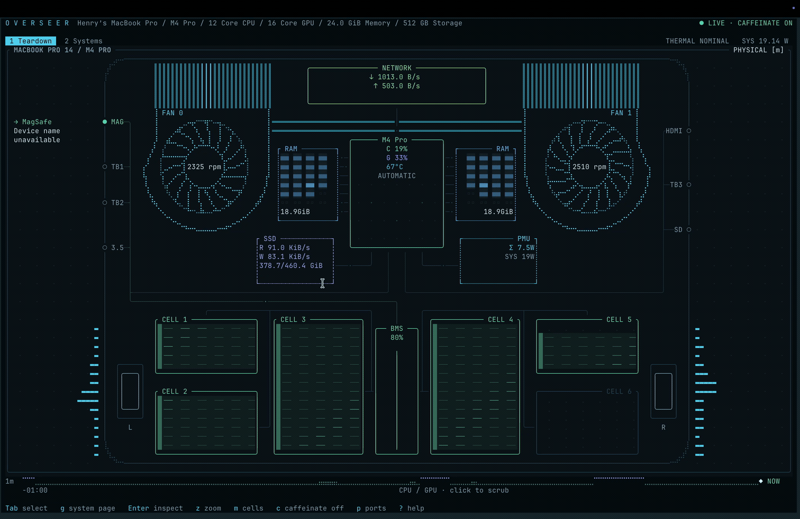

# Overseer

activity monitor but its in terminal and looks cool 👍

hardcoded to match my own laptop

Battery and Energy show the configured charge limit, Optimized Battery Charging, and active power mode. Charging settings refresh about every five seconds through macOS's private PowerUI interface, without sudo; unavailable or stale readings are labeled. These stats are read-only.
